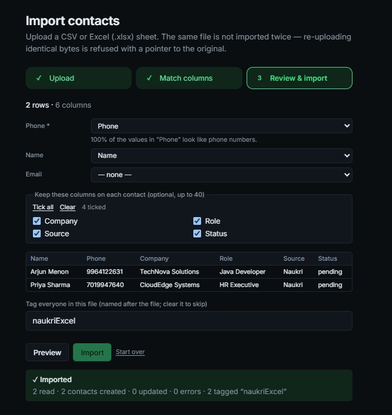
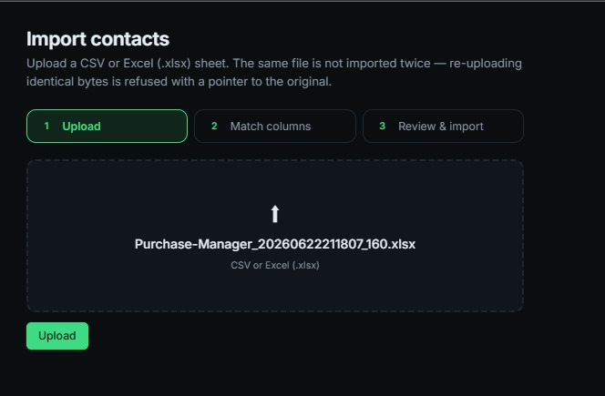
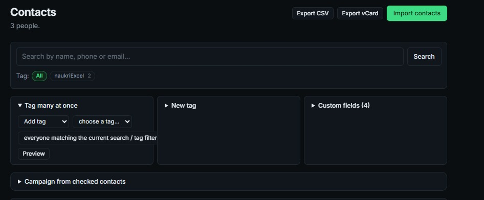
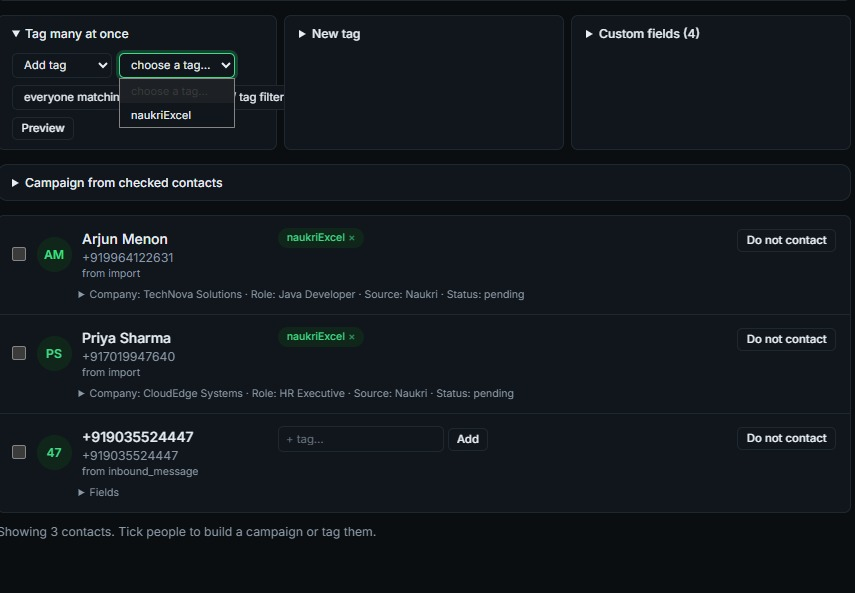
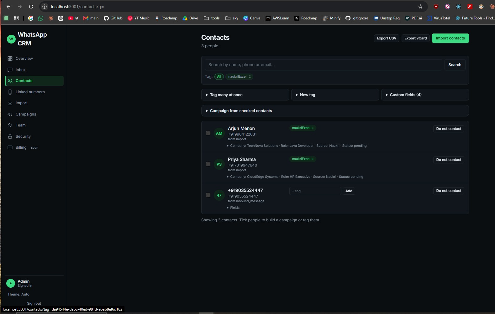
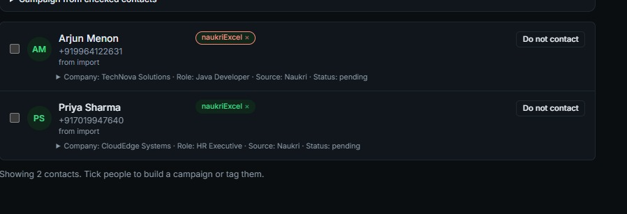
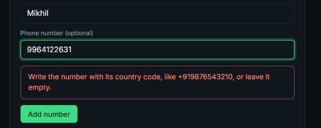
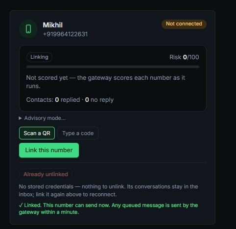
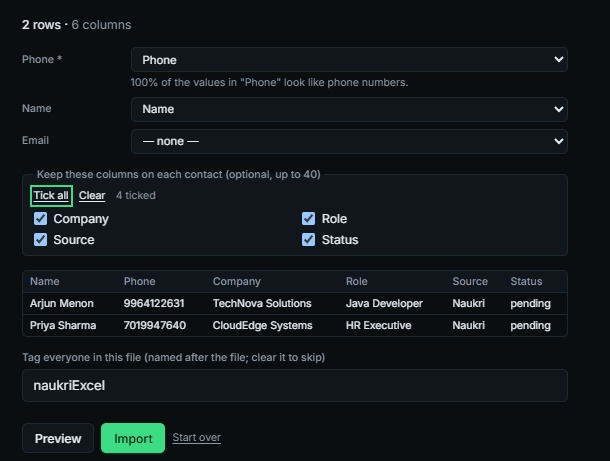

# Dev feedback issues

Issues pointed out by the other dev (Mikhil) after running the app on his PC.
Each item: title, screenshot, the original text (all of it is from Mikhil), my understanding, then Kushal's decisions.

> **Word used below: "chip"** means a small rounded label on the screen, such as a tag name shown on a contact or in the Tag filter row.

## ✅ issue-1: Add "what next" links after each step (guided flow)

**Original text (Mikhil):**
> after they click on import take them to tag or something like that.. if oyu just end it here it makes it look sus..
>
> like see i just want like an ideal flow init..
> THE NORMAL GUY USING THE APP DOES THIS:
> 1. login
> 2. go to numbers and scan qr
> 3. come to excel to import
> 4. goes to "tag" or imported sheet
> 5. sends messages to them
>
> so why cant we have buttons to indications in the screen that just tkaes them there? nothing fancy.. just shit you know the user will 100% do after taking action.. like you know they be going to import or campaigns after linked numbers... and after importing they be going wanting to send messages to them.. so why not add a link there AND ONLY MAKE SURE THERE'S A BUTTON OR OPTIONS SHOWING UP AFTER THEY FINISH IMPORTING...
>
> it makes look simple and ui friendly.. you can suggest them to go.. but not force them...

**My understanding:**
- After linking a number → suggest Import (or Campaigns).
- After an import finishes → show a button/option to go to the tag / imported sheet and to send messages to them.
- Nothing fancy. Only show these once the action has finished. Suggest, never force.
- The screenshot is the dead end Mikhil means: after Import, the page only shows "✓ Imported · 2 read · 2 contacts created · 0 updated · 0 errors · 2 tagged \"naukriExcel\"" and nothing else. This is where the "View contacts / tagged sheet" and "Send messages" buttons should appear.

**Kushal's decisions:**
- Understanding is right.
- Might need to start on the import wizard as well.

## ✅ issue-2: Import page: show how many rows are in the file

**Original text (Mikhil):**
> also if possible can you show the user how many rows are there? idk if they double check everything before importing... is it possible?

**My understanding:**
- Import contacts, step 1 (Upload) has no row count, so users can't sanity-check the sheet before importing.
- Show the row count, at least by the Review & import step, ideally right after the file is chosen.
- Possible: the file is parsed for column matching anyway, so the count should be available.

**Kushal's decisions:**
- Understanding is right.
- Remove the Upload button: once the file is selected or dropped in, it uploads automatically.
- Show an error if the file is invalid, doesn't have enough rows, etc.

## ✅ issue-3: Contacts: "Tag many at once" dropdown stretches out of its box

**Original text (Mikhil):**
> dis dropdown is stretching out of screen..

**My understanding:**
- The select reading "everyone matching the current search / tag filter" is too wide and runs past the panel's right edge.
- It should fit inside the panel (full width of the card, truncate or wrap the text).

**Kushal's decisions:**
- Just a UI fix.

## ✅ issue-4: Contacts: "choose a tag..." option looks dim

**Original text (Mikhil):**
> highlight that choose a tag option OR you can have remove that and have a "no tag" option somrehing.. it looks kinda dim now

**My understanding:**
- In the open tag dropdown the "choose a tag..." entry is greyed out and hard to see.
- Either highlight it properly, or remove it and use a clear "No tag" option.

**Kushal's decisions:**
- Add a "No tag" option at the bottom of the list.
- If they select "No tag", show a warning: if they don't tag now, they'll need to reselect / retag all those contacts again later.
- The "choose a tag..." option stays greyed out but still visible.

## ✅ issue-5: Contacts: clicking a tag chip does nothing, and the tag GUID shows in the URL (built; the tag chip now shows it is loading, but I could not reproduce the original "click does nothing" in a browser, so please check it)

**Original text (Mikhil):**
> clicking on tag does not work IT DOESN'T TAKE ME ANYTHING.. IF I OPEN IN NEW TAB IT WORKS...i mean can see the tag GUID.. feels sus is it fine if we can show the tag id to the end user?

**My understanding:**
- Clicking a tag chip (e.g. "naukriExcel") in the Tag filter row doesn't filter or navigate. Opening it in a new tab works.
- The URL is `/contacts?tag=<GUID>`, so the raw tag ID is visible in the address bar.
- Two things: (1) fix the click so it filters; (2) decide whether showing the GUID is OK or whether to use the tag name/slug. Likely harmless if IDs are random UUIDs and access is workspace-scoped.

**Kushal's decisions:**
- The UUID is irrelevant to the user.
- Once they tag and select a few contacts, offer a suggestion to start a campaign with the tagged/selected numbers.
- If they have only selected numbers (no tag yet), they need to tag them first, and only then go to a campaign.
- If a campaign already exists with those numbers as a subset, ask: use this tagged group, or create a new one?

## ✅ issue-6: Contacts: tag removal ("x" on the chip) is too easy

**Original text (Mikhil):**
> don't make dis ez to remove tag.. i dont think they be able to "categorize" users with anything else other than dis.. maybe add a are oyu sure button

**My understanding:**
- One click on the "x" removes the tag straight away.
- Tags are basically the only way to categorize contacts, so an accidental removal is costly.
- Add an "Are you sure?" confirmation first.

**Kushal's decisions:**
- Yes, add the confirmation.
- If they untag a contact they may have to search for that contact again and re-tag it. The warning should say exactly that.

## ~~issue-7: GitHub Actions minutes at 90%~~

~~Removed. Kushal added this by mistake (it is his own GitHub billing email, not feedback from Mikhil). Ignore it.~~

## ✅ issue-8: Add number form: country code should be a dropdown, phone field numbers-only

**Original text (Mikhil):**
> make changes to have that country code as a dropdown a ndonly accept numbers here...  i can add letters also here (whjen accessing gfrom fone if the text box is number only the keypad changes ig)

**My understanding:**
- The "Phone number (optional)" field makes users type the country code themselves (error: "Write the number with its country code, like +919876543210, or leave it empty."). Typing `9964122631` without it fails.
- Replace that with a country code dropdown next to the field, so users only type the local number.
- The field should only accept digits (no letters). Using a numeric input mode also brings up the number keypad on phones.

**Kushal's decisions:**
- Default the country code using the user's current location; they can use the dropdown to pick another one.
- If they start typing with +91, +63 etc., set that as the country code and let them continue (like Google does when adding a phone number to a new account).

## ✅ issue-9: Linked numbers: still shows "Not connected" after scanning the QR (needs reload)

**Original text (Mikhil):**
> diff b/w linked and connected? coz i scanned and it still shows not connected...
>
> if i reload it works.. think issa refresh issue, maybe you can add that

**My understanding:**
- After scanning the QR the card still shows the "Not connected" badge, "Already unlinked" and "No stored credentials", while the green line below says "Linked. This number can send now." So the screen contradicts itself until the page is reloaded.
- Likely the status isn't refreshing after the scan succeeds. Fix: auto-refresh (or update the card state) as soon as the link succeeds.
- Open question: what is the difference between "Linked" and "Connected" in the UI? If they mean the same thing, use one word.

**Kushal's decisions:**
- Once linked, grey out "Link this number" / "Scan a QR" / "Type a code".
- Linked and connected mean the same, so keep the word "Linked".
- Add auto-refresh.

## ✅ issue-10: Import "Match columns" step is confusing (what are the dropdowns and checkboxes?)

**Original text (Mikhil):**
> how dis work? i mean what is the dropdown and what is this checkbox's form?()

**My understanding:**
- Dropdowns (Phone *, Name, Email): tell the app which column of the spreadsheet holds each of those contact fields. They are pre-picked automatically (the hint "100% of the values in 'Phone' look like phone numbers" is the app checking its guess). Phone is required; Name and Email can be "none".
- Checkboxes ("Keep these columns on each contact"): every other column in the sheet (Company, Role, Source, Status) that you tick is saved on each contact as an extra custom field (up to 40). Unticked columns are dropped. This is why "Custom fields (4)" shows on the Contacts page.
- The table below is a preview of the first rows, and the tag box names the tag everyone in this file gets (defaults to the file name).
- Takeaway: it works, but a normal user won't know this. Add short helper text/labels (e.g. "Which column is the phone number?", "Extra info to keep on each contact").

**Kushal's decisions:**
- Helper text understanding is right.
- Add a big text saying "select the columns to be stored" (shown after phone, name, email are selected). Right now it's only the small "Keep these columns on each contact" text at the top.
- Add a line at the top of the preview: "Preview of all the columns you have selected from the excel/csv: <excel-file-name-here>".
