# Dev feedback issues (prod testing, 2026-10-22)

Issues the other dev (Mikhil) hit while using the app in prod.
Each item has the screenshot, what he said (his words, kept as written), and a short summary of what it means.

Screenshots are in `dev-feedback-prod-images/`. A separate earlier round of feedback lives in `dev-feedback-issues.md`.

**Priority:** issue 13 (the "Waiting for this message" problem) is marked PRIORITY FIX by the dev.

## Index

| # | Issue | Area |
|---|-------|------|
| 1 | Preview vs Import buttons are unclear | Import |
| 2 | Duplicate numbers don't update the name, and aren't flagged | Import |
| 3 | Tag filter is slow, shows no loading state, and "All" got stuck | Contacts |
| 4 | "Tag many at once" Preview shows nothing | Contacts |
| 5 | No feedback after clicking buttons (10 duplicate drafts) | App-wide |
| 6 | No way to remove a number | Linked numbers |
| 7 | No way to delete tags and other items (needs "Are you sure?") | App-wide |
| 8 | Custom fields panel can't handle 43 fields | Contacts |
| 9 | No template picker when creating a campaign | Campaigns |
| 10 | No feedback after Start, and skipped contacts not warned about | Campaigns |
| 11 | "Start with overrides..." popup is hidden and unreadable | Campaigns |
| 12 | Nowhere in the UI to enter the AI API key | AI assistant |
| 13 | "Waiting for this message" still happens (PRIORITY) | Messaging |

---

## issue-1: Import: Preview and Import buttons are unclear

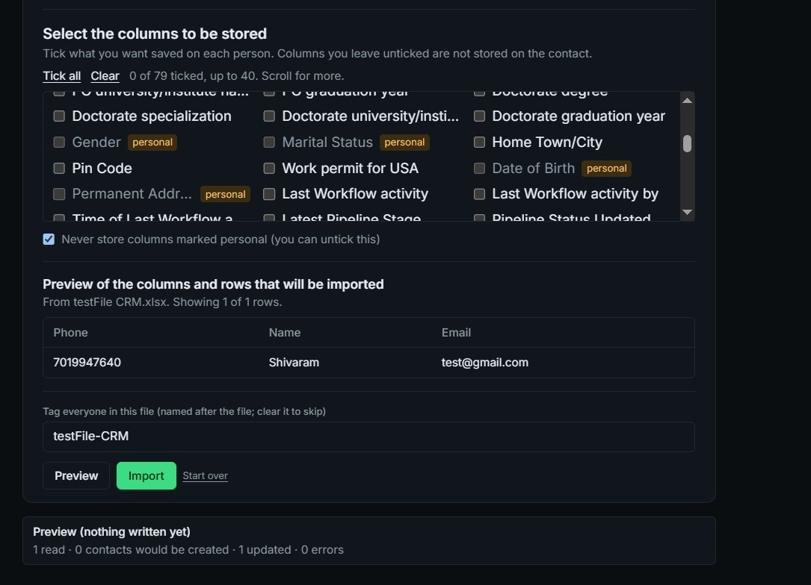

**Original text (Mikhil):**
> dis is not clear, i mean what is preview meant do? and hwy iare we restricting the user from clicking import?
>
> i mean it would help if you showed or told what preview does here.. makes it more intitutive...
>
> if you want to block the import anyways why not just make the button appear only after preview?

**Summary:**
- It isn't clear what Preview does.
- It isn't clear why Import is restricted.
- Explain what Preview does on the screen.
- If Import is blocked until a preview has run, show the Import button only after Preview.

---

## issue-2: Import: duplicate numbers don't update the name, and aren't flagged

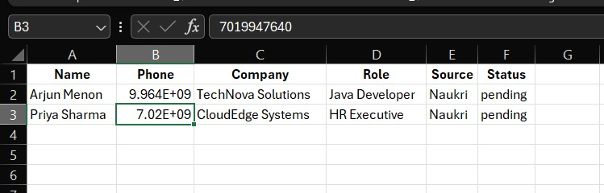
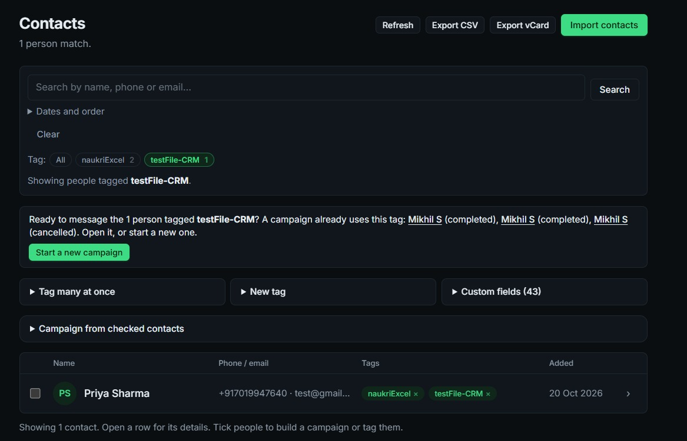

**Original text (Mikhil):**
> i added my mom's number and it shows "priya sharma" but in the excel it shows shivaraman...
>
> i put 2 excel files.. and they have same number but different names..
>
> so i think it's not "updating" names..
>
> see how to better handle duplicate records... and shi..
>
> in my opinion it should highlight to the user that dis name is already there in DB and that you're updating it.. AFTER THE USER CLICKS ON PREVIEW...

**Summary:**
- Two Excel files had the same phone number with different names. The contact still shows "Priya Sharma" (from the first file); the second file's name was not applied.
- The number was matched as the same person: one contact, tagged `naukriExcel` and `testFile-CRM`.
- After Preview, the screen should highlight "this person is already in the database and will be updated".
- Duplicate handling needs a better design overall.
- The Excel screenshot shows phone numbers as `9.964E+09` (Excel's scientific notation). The cell's real value is `7019947640`, so this is only how Excel displays it.
- The campaign banner for the `testFile-CRM` tag lists three campaigns all named "Mikhil S" (two completed, one cancelled), with no way to tell them apart.

---

## issue-3: Contacts: tag filter is slow and gives no loading feedback

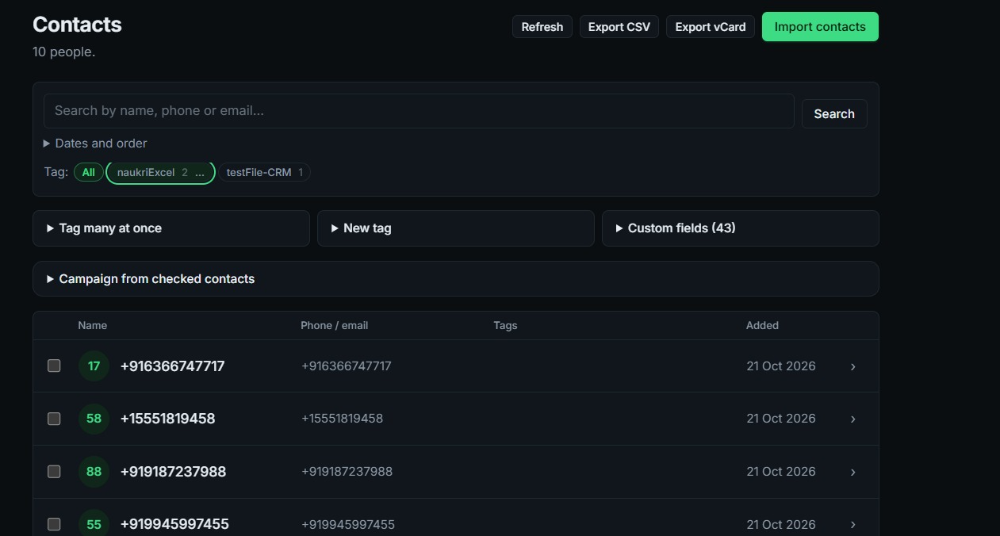
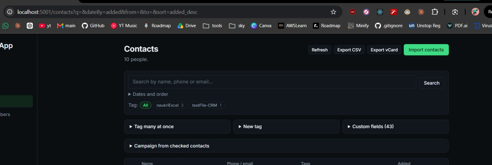
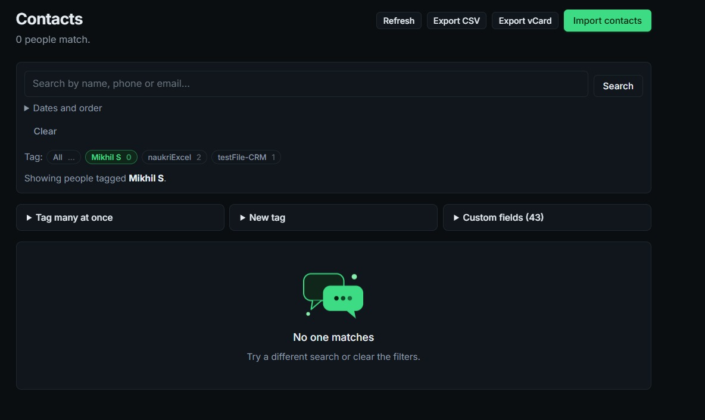

**Original text (Mikhil):**
> clicking on dis tag thing dos not do anything, i was hoping it would filter and show the numbers down...
>
> plus even after i click on dis tag and click on search i thought it would search but even that doesn't work, it refereshes page das it

> i am able to see the URLs change, but screen is not filtering shi

> I think clicking on tags does work but it's way too slow, plus that 3 dots next to the text is apparently showing that it's loading but i thought it was a UI bug.. if it's loading add that circle thing or something, and make it foster.. i mean if it's just selecting stuff it shouldn't that long...

> i clicked on show all 2 mins back and it's still loading, idk if it's work also

**Summary:**
- At first the dev thought the tag click did nothing and Search only refreshed the page. Later he found it does work, but it is very slow.
- The "..." on the chip (for example `naukriExcel 2 ...`) is a loading indicator, but nothing says so. He took it for a UI bug. Use a proper spinner or "Loading..." state.
- Selecting a tag should be fast.
- Clicking "All" was still loading after 2 minutes, with no spinner, timeout or error. The page stayed on the old filter ("Showing people tagged Mikhil S", "0 people match").
- The URL in the address bar was `localhost:5001/contacts?q=&dateBy=added&from=&to=&sort=added_desc`, with no tag in it, when the dev said the list wasn't filtering.
- The listed contacts have only phone numbers as names (for example +916366747717) and an empty Tags column.

---

## issue-4: Contacts: "Tag many at once" Preview shows nothing

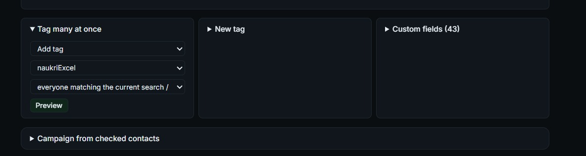

**Original text (Mikhil):**
> dis tag many at once also doesn't work. i mean i click on preview and shi and nothing shows up..

**Summary:**
- The panel was set to Add tag, `naukriExcel`, "everyone matching the current search /...". Clicking Preview showed no count, no list and no message.
- Same problem as issue 1: Preview gives no feedback.
- The third dropdown's text is cut off ("everyone matching the current search /...").

---

## issue-5: App-wide: no feedback after clicking buttons

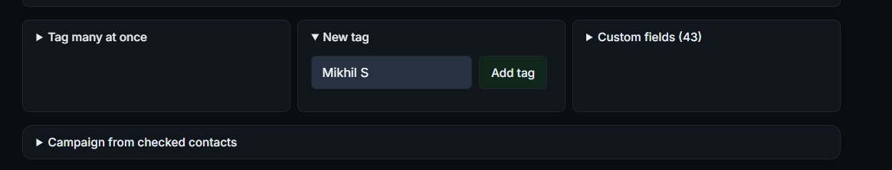
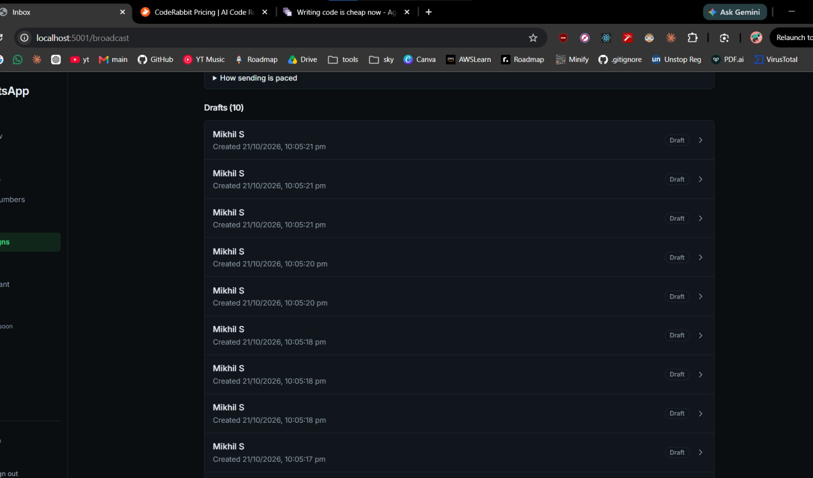
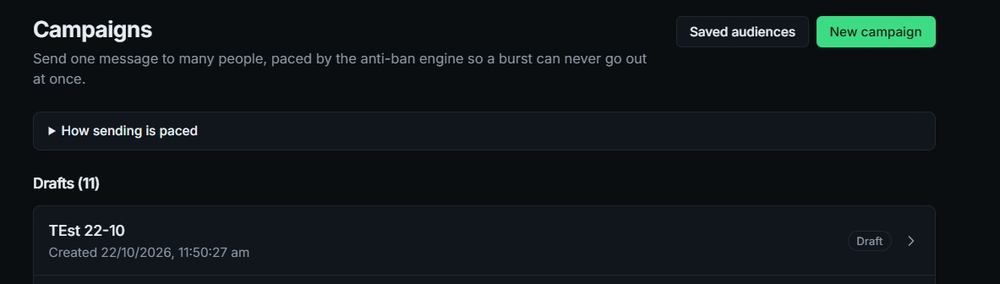

**Original text (Mikhil):**
> add tag does WORKS BUT IT DOESN'T REDIRECT THE USER ANYWHERE...
>
> i think dis a issue everywhere in app... like if you're not redirecting or informing the user after they click on button they won't know and keep clicking on it

> even yesterday's campaign shi, i clicked on create draft but it does not take me anywhere, so i thought nothing happened and clicked on it 5 to 10 times and after a while when i came back i saw dis shi

> draft created but user does not know shi.. dis what i meant when i told improve visibility.. LET THE USER KNOW MROE DETAILS

> (from issue 12) check some other buttons also make sure they refresh or soemthing

**Summary:**
- New tag works, but the page shows no sign of it. The user can't tell it worked.
- Create draft gave no redirect or message, so the dev clicked 5 to 10 times and created **10 duplicate drafts** ("Drafts (10)", all "Mikhil S", created within 4 seconds of each other on 21/10/2026).
- After creating a draft ("TEst 22-10"), the Campaigns list shows no confirmation. The draft row shows only a name, a created time and a "Draft" badge. It doesn't show audience size, message snippet or sender number, so identical drafts are hard to tell apart.
- Expected: after any action, redirect or show a clear confirmation ("Draft created") with details. Disable the button after the first click, or show "Creating...".
- The dev also asked for the other buttons in the app to be checked for the same problem.

---

## issue-6: Linked numbers: no way to remove a number

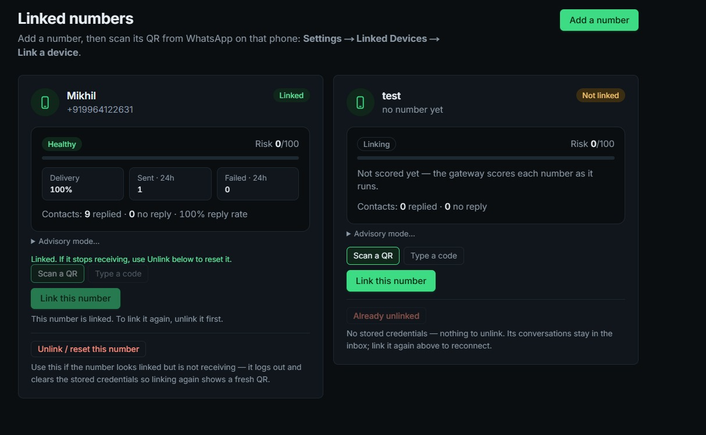

**Original text (Mikhil):**
> make it possible to "remove" or delete numbers here

**Summary:**
- Each card has only "Link this number" and "Unlink / reset this number". Unlink clears the stored credentials but the card stays.
- The "test" card ("Not linked", "no number yet", "Already unlinked") can't be removed at all.
- Add a Remove / Delete option, with the confirm step from issue 7.

---

## issue-7: App-wide: no way to delete tags and other items

*(no screenshot)*

**Original text (Mikhil):**
> make it possible to delete tags and other shi also.. but add like are you sure prompt or ssomething

**Summary:**
- Tags (and "other shi", meaning other items across the app) can't be deleted.
- Every delete should ask "Are you sure?" first.
- Related to issue 6 (removing numbers) and issue 8 (`remove` on custom fields has no confirmation).

---

## issue-8: Contacts: Custom fields panel can't handle many fields

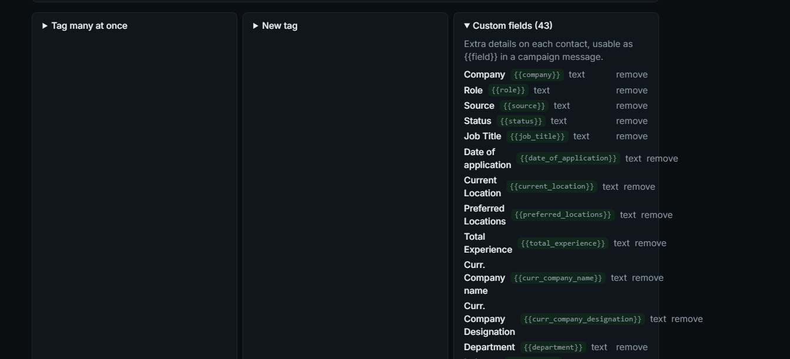

**Original text (Mikhil):**
> dis one's design it not make for multiple tags i think you might have to restructre shi

**Summary:**
- With 43 fields in a narrow column, long names wrap over 2 or 3 lines (Date of application, Curr. Company Designation).
- The `text` type and the `remove` link end up at uneven positions, and some overflow the panel's right edge.
- It was designed for a few fields. Restructure it, for example a searchable list or table, a scrollable area and a fixed actions column.
- `remove` has no "Are you sure?" (see issue 7).

---

## issue-9: Campaigns: no template picker on New campaign

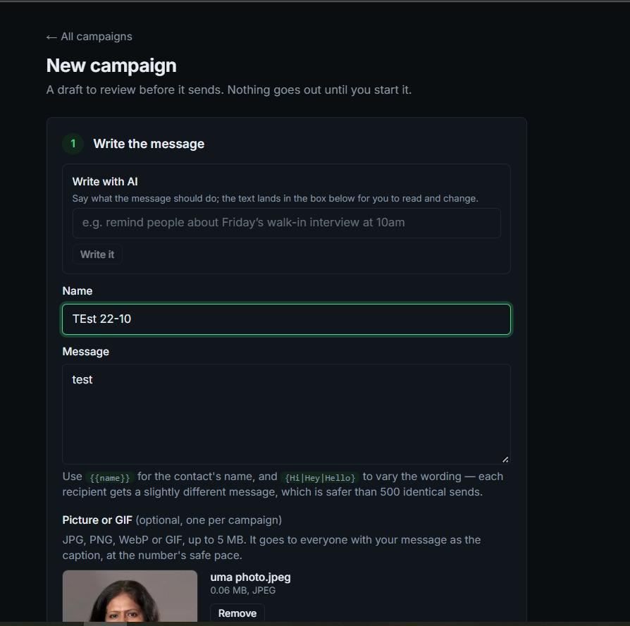

**Original text (Mikhil):**
> where is the template dropdown or asking the user to go to template screen if they need to build stuff?

**Summary:**
- Step 1 "Write the message" has only Write with AI, Name and a free-text Message box.
- There is no dropdown to pick a saved template and no link to the template screen to build one.
- Add both: a template dropdown that fills the message, and a "Build a new template" link.

---

## issue-10: Campaigns: no feedback after Start, and skipped contacts are only shown afterwards

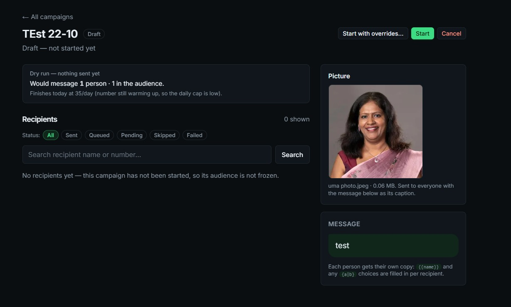
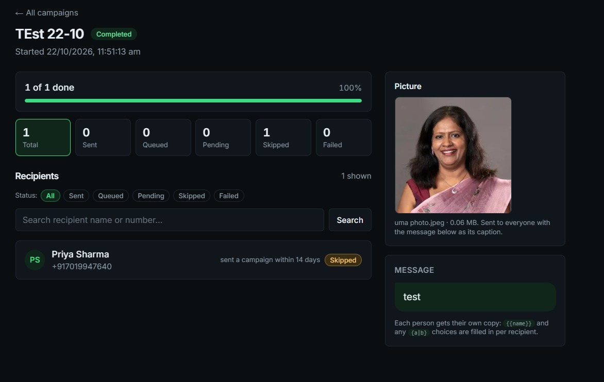

**Original text (Mikhil):**
> clicked on start but idk what happened, is the user getting message? is something happening? is it stuck? idk

> when i clicked on send it showed taht it skipped coz 14 days.. instead why not just tell the user that out 50 contacts in campaign 3 of them were already reached out to previously for another campaign called: "campaign name" or something
>
> there you can have shit called send anyways or send without that cnaidates and then you can progress bar or a loading screen here that shows taht it's being sent

**Summary:**
- After Start the page still looked like a draft ("Draft — not started yet", "0 shown"). The dev couldn't tell whether it was sending, queued or stuck.
- The campaign finished as Completed (started 22/10/2026, 11:51:13 am): Total 1, Sent 0, Skipped 1. Priya Sharma (+917019947640) was skipped with the note "sent a campaign within 14 days". The earlier dry run had said "Would message 1 person".
- Before Start, warn the user: "3 of 50 contacts were already messaged in another campaign, 'campaign name'". Name the earlier campaign, not just "14 days".
- Offer "Send anyway" or "Send without those contacts".
- Show a progress bar or loading screen with live counts (sent, queued, failed) while sending. Disable the buttons while it starts.
- The progress bar showed 100% "1 of 1 done" even though nothing was sent. "Done" should separate sent from skipped.

---

## issue-11: Campaigns: "Start with overrides..." popup is hidden and unreadable

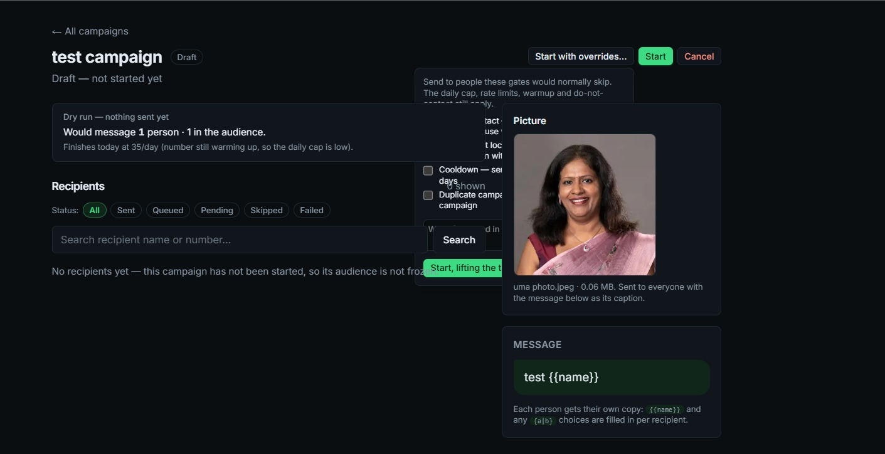

**Original text (Mikhil):**
> can't send with overrides even if i want to override.. coz i can't see what there

**Summary:**
- The popup opens behind the Picture panel and over the Recipients area, so most of its text is cut off or overlapped.
- Visible fragments: a note ("Send to people these gates would normally skip. The daily cap, rate limits, warmup and do-not-contact still apply."), a "Cooldown... days" checkbox, a "Duplicate campa... campaign" checkbox, a text box, and a green "Start, lifting the t..." button that is cut off.
- The dev can't use overrides because he can't see what he'd be overriding.
- Give the popup its own top layer and make each override's effect clear. These overrides are probably how the user would pick "Send anyway" from issue 10.

---

## issue-12: AI assistant: nowhere in the UI to enter the API key

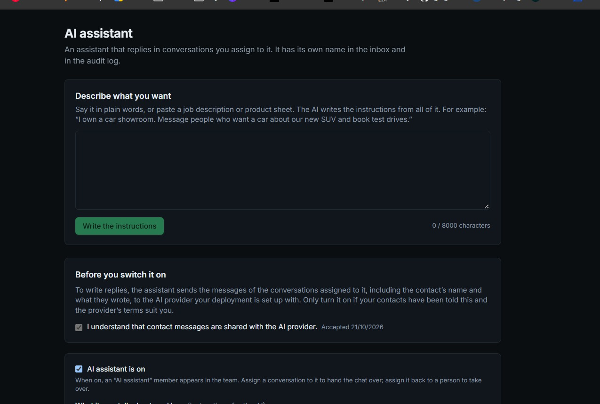

**Original text (Mikhil):**
> api key idk where to put.. make sure the api key is addable from UI, not from .env... if you're giicing a whitelabelling shi to mfs, you ideally don't want them fuck with setup and shit
> and make sure api is securely stored including proper encryption
> check some other buttons also make sure they refresh or soemthing

**Summary:**
- The page has "Describe what you want", the consent box and the "AI assistant is on" toggle, but no API key field.
- The key must be added from the UI, not from `.env`. The app is meant to be white-labelled, and customers shouldn't touch setup files.
- Store the key securely with proper encryption at rest, and don't show it back in full after saving.
- Check the other buttons for the same no-feedback problem (see issue 5).

---

## issue-13: PRIORITY FIX: "Waiting for this message" still happens

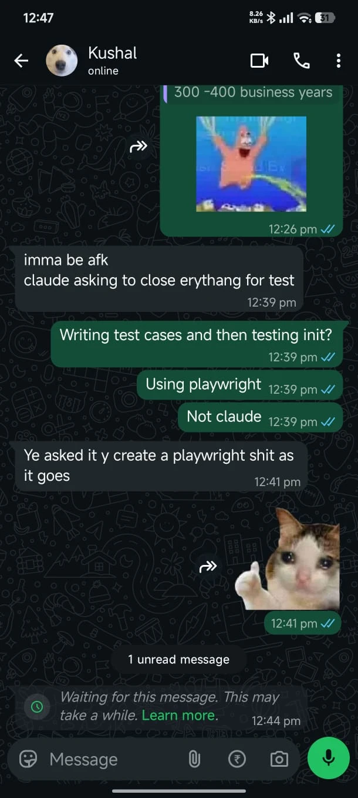

**Original text (Mikhil):**
> the crm still has the waiting for this message issue THIS SHOULD BE PRIORITY FIX

**Summary:**
- In a WhatsApp chat on a phone, the 12:44 pm message shows "Waiting for this message. This may take a while. Learn more." and doesn't arrive. The chat shows "1 unread message".
- The other messages at 12:39 to 12:41 pm arrived normally with double ticks.
- This is WhatsApp's usual sign that the receiving phone couldn't decrypt the message.
- Worth checking first: a damaged or out-of-sync session, since an earlier gateway restart broke the real WhatsApp session in this project.
- The dev marked it as the priority fix, ahead of everything else here.
