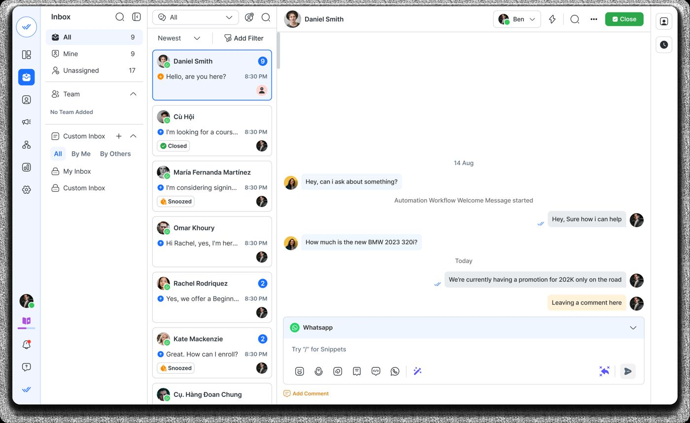
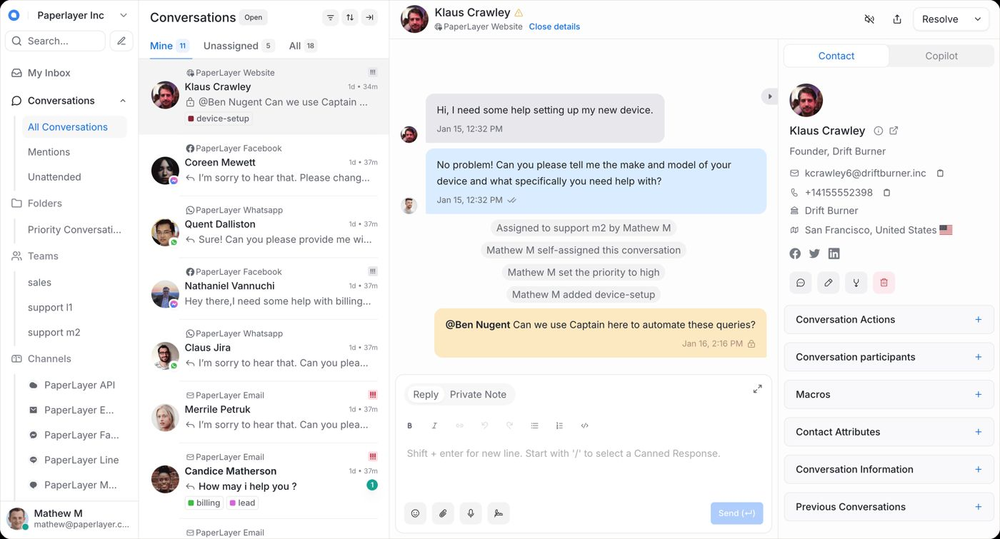
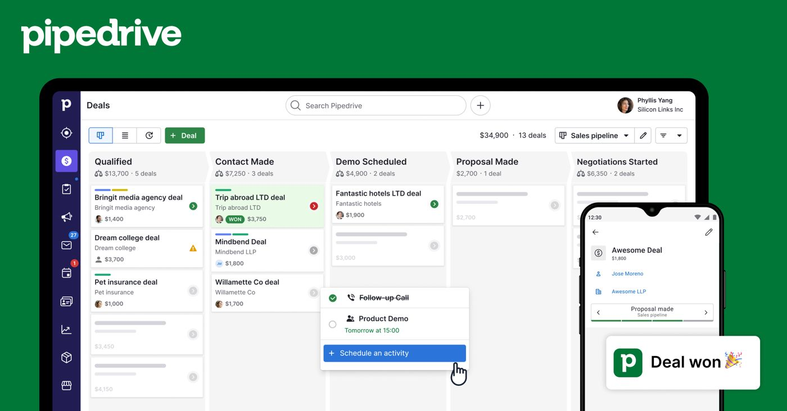
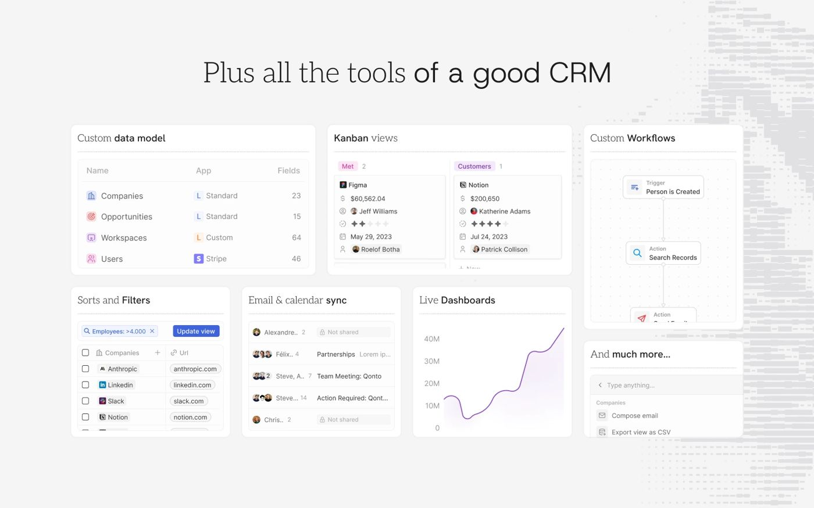

# 01 · Vision & scope

## The one-line version

A conversation and outreach platform for WhatsApp that anyone can self-host, that makes no
assumptions about your business, and that treats WhatsApp as one adapter behind a port.

## The problem

Teams that run their business on WhatsApp end up in one of three bad places:

1. **A personal phone.** No history when someone leaves, no assignment, no reporting, no
   opt-out tracking, and a compliance exposure nobody has thought about.
2. **A SaaS WhatsApp CRM.** Wati, AiSensy, Interakt and the rest work well, but you rent
   your conversation history, pay a 12–20% markup on top of Meta's per-message rate, and
   cannot run the thing on your own infrastructure or extend it beyond what their roadmap
   allows.
3. **A bespoke internal tool.** Which becomes `docs/00-prior-art.md`.

The gap: **a self-hostable, API-first, genuinely generic messaging CRM that supports both
the free unofficial transport and the paid official one, with the anti-ban engineering the
free path actually requires.**

## Who it is for

| Persona | What they need | What they'll judge it on |
|---|---|---|
| **Solo operator / small agency** | One number, a few hundred contacts, bulk outreach that doesn't get them banned | Does it install in 10 minutes on a €5 VPS and not get my number killed |
| **Small team (3–15 agents)** | Shared inbox, assignment, no two agents replying at once, basic reporting | Does the inbox feel as fast as WhatsApp Web |
| **Developer embedding it** | A real API, webhooks, no surprises | Can I drive the whole thing without reading the source |
| **Self-hosting engineer** | Predictable resources, backups that work, upgrades that don't break | Can I reason about what it will cost and what happens when it breaks |

The first three are the v1 audience. The fourth is the one who decides whether it survives.

## Principles

1. **Channel-agnostic core.** The word "WhatsApp" appears in `packages/channels/*`, in
   migrations for channel-specific columns, and nowhere else in the core.
2. **Nothing domain-specific in the schema.** No `candidate`, no `job`, no `deal`. Pipelines,
   stages, custom fields and tags are user-defined rows, never enums in code.
3. **One send path.** Every outbound message — campaign, agent, human reply, API call,
   automation — passes the same dispatcher, the same policy gates, the same rate limiter.
   This is not a style preference; it is the only way the anti-ban guarantees hold (M12).
4. **API-first.** The web UI is a client of the public API. If the UI can do it, the API can
   do it. No private endpoints the UI alone enjoys.
5. **Free by default, paid by choice.** Every external resource has a free self-hostable
   driver and a managed alternative. No paid service is ever required to run the product.
6. **Small by default.** The default install is the smallest useful thing. Telemetry, LLM,
   object storage, Redis and antivirus are all opt-in, because a 2 GB box should not spend
   half its memory watching itself.
7. **Honest about risk.** The docs say plainly that Baileys can get a number banned, that
   the engine reduces but cannot eliminate that, and that compliance is the operator's
   responsibility.

## Scope

### In scope for v1

Shared inbox and contacts · bulk campaigns with the full anti-ban engine · pluggable data
ingestion · public API and webhooks · both WhatsApp transports with intent-based routing ·
templates · opt-out handling · single-tenant deploy on a multi-tenant-ready schema.

### Explicitly out of scope

- **Being an ATS, a helpdesk, or a sales CRM.** No domain objects. Others build those on top.
- **Being a BSP.** We talk to Meta; we do not resell WhatsApp access.
- **Commerce** — catalogue, cart, WhatsApp Pay. Region-locked and a product in itself.
- **Voice and video.**
- **A visual journey builder**, before the primitives underneath it are solid.
- **Mobile apps.** The web UI is responsive; that is the v1 answer.
- **Multi-tenant SaaS operations** — billing, plan limits, signup funnels. The *schema* is
  ready; the business around it is not built.

### Deliberately deferred

| Thing | Why deferred | Seam kept |
|---|---|---|
| AI agent (F12) | The heaviest dependency, the least certain value, and an unresolved privacy question | `LlmDriver` port; the agent is just another producer writing into the same outbox |
| Multi-tenancy in operation | No second tenant yet | `org_id` + RLS on every table from migration 1 |
| Kubernetes | One VPS covers the v1 audience | 12-factor, stateless, health endpoints — a Helm chart is additive |
| Channels beyond WhatsApp | Focus | `ChannelProvider` port with capability declaration |

## Market research, 2026-10-10 — what the others have that we do not

A second pass over the field, done to find gaps (the earlier pass is
[`03-competitive-analysis.md`](03-competitive-analysis.md), which this extends rather than replaces).
**How much to trust it:** feature lists come from each vendor's own pages; pricing and the "cons" come
from review sites and *competitors'* blog posts, which are not neutral. Treat the pricing as an order of
magnitude and re-check before quoting. The WhatsApp-first tools (Wati, Interakt, AiSensy, Zoko) keep
their product UI behind a login, so their interface is described from docs and marketing only — the
screenshots below are the ones that were publicly available.

### Who was looked at

| Group | Products | What they are |
|---|---|---|
| WhatsApp-first (official API, SaaS) | **Wati**, **Interakt**, **AiSensy**, Zoko, Gallabox, ChatDaddy | Shared inbox + broadcast + no-code bot, sold per seat plus a 12–25% markup on Meta's per-message rate |
| Omnichannel inbox | **Respond.io**, Trengo, **Chatwoot** (open source) | One inbox across WhatsApp, Instagram, Messenger, email, live chat; routing, SLA, reports |
| General CRM | **HubSpot**, **Pipedrive**, **Twenty** (open source), Zoho CRM | Contacts, deals pipeline, tasks, email, reports; WhatsApp is an add-on |
| Recruitment | **Zoho Recruit**, **Bullhorn**, **Naukri RMS**, Manatal | ATS + CRM: resume parsing, job boards, candidate pipelines, interview scheduling |

### Features they have and we do not (yet)

Ordered by how often it appeared and how much it matters to the people this product is for.

| Gap | Who has it | Where it stands here |
|---|---|---|
| **Message templates** with Meta approval status, in a library | Wati, Interakt, AiSensy, Respond.io | Pinned D-19 |
| **No-code chatbot / flow builder**, keyword auto-replies | Wati, Interakt, AiSensy, Respond.io, Chatwoot | Out of scope until the primitives are solid (see above); keyword auto-reply is the cheap first step |
| **AI agent** answering and handing off to a human | Wati (Astra), Respond.io, Interakt, Chatwoot (Captain), HubSpot | Deferred (F12); human takeover pinned D-42 |
| **Scheduled broadcasts** (up to 2 months ahead) | Wati, AiSensy | Not built; campaigns start now or never |
| **Ready-made behavioural segments** (highly engaged, win-back, at risk) | Wati | We have saved audiences and filters, but no engagement-based presets |
| **Delivery / read / click / reply analytics** per campaign and per agent, plus CSAT | Wati, AiSensy, Respond.io, Chatwoot | Per-recipient results exist; no agent/team reports, no read/click rates |
| **Pipeline / lifecycle stages** (New lead → Hot → Customer) with a kanban | Wati, Respond.io (Lifecycle), Pipedrive, HubSpot, Twenty | Not built; deliberately no domain objects, so it would be a user-defined stage field |
| **Snooze**, **@mentions**, collisions, "collaborations" inbox | Respond.io, Chatwoot | Thread lock only; D-17 / D-18 |
| **Saved custom inboxes** (e.g. "Morning shift", "VIP customers") | Respond.io | Only mine / unassigned / all × open / closed |
| **SLA, business hours, auto-assignment, agent capacity** | Chatwoot, Respond.io | Not built |
| **Slash snippets with variables** (`/` snippet, `$` variable, `:` emoji) and a command bar | Respond.io, Chatwoot | We have a saved-reply picker; no inline `/` |
| **Contact merge suggestions** | Respond.io | We merge LID duplicates automatically; no manual suggestion UI |
| **Click-to-WhatsApp ads**, attribution, **WhatsApp Flows / forms**, catalogue, in-chat payments | Wati, Interakt, AiSensy | Commerce is out of scope; CTWA attribution and Flows are listed as schema-ready |
| **Integrations**: Zapier, Shopify, HubSpot / Salesforce / Zoho sync, outbound webhooks | All of them (Wati 100+) | P9 (webhooks, OpenAPI); nothing yet |
| **Other channels**: Instagram, Messenger, SMS, email, live chat, voice calls | Respond.io, Wati, Interakt, Chatwoot | Out of scope; `ChannelProvider` port keeps it possible |
| **Resume parsing, job-board posting, candidate scorecards, interview scheduling** | Zoho Recruit, Bullhorn, Naukri RMS, Manatal | Out of scope (we are not an ATS); this is the host app's job via the API |
| **Self-service signup, billing, SSO / 2FA**, mobile app, knowledge base | Most | Signup/billing pinned D-47 (built once, reverted for now); SSO and mobile not planned |

### What we have that most of them do not

- **Self-hostable and API-first**, with no per-message markup on the unofficial path.
- **An anti-ban engine with a visible sender-health panel, silent-restriction detection and a
  simulation harness.** The WhatsApp-first SaaS tools sit on the official API and do not need one; the
  unofficial tools rarely show theirs.
- **Do-not-contact enforced on every send path with an audited admin override**, and an append-only
  audit log written in the same transaction as the change.
- **Row-level security on every tenant table**, proved by tests that query with no filter.
- **A real ingestion path** (CSV / Excel, dry run, per-row ledger, content-hash dedup) where most tools
  stop at "upload CSV".

### Interface patterns worth copying

Screenshots are in [`assets/competitors/`](assets/README.md); these are the patterns, with what each
one costs.

| Pattern | Seen in | Why it works | Cost / caution |
|---|---|---|---|
| **Narrow icon rail → section list → conversation list → thread → slim right rail** | Respond.io | Four columns that each do one job; the left list doubles as a saved-view switcher with live counts | Dense on small screens; needs a mobile collapse |
| **Tabs with counts** (Mine 11 · Unassigned 5 · All 18) and a source label on every conversation | Chatwoot, Respond.io | Tells an agent what needs them without opening anything | Counts must update live or they erode trust |
| **Activity events inline in the thread** ("assigned to…", "set priority to high", "closed by contact merge") | Chatwoot, Respond.io | The thread becomes the audit trail an agent actually reads | Needs an event stream per conversation |
| **Internal comments in a different colour**, composer with Reply / Private note tabs | Chatwoot, Respond.io | Makes it hard to send a note to a customer by mistake | We already separate notes by construction; the colour cue is cheap |
| **Right panel as collapsible sections** (actions, participants, macros, attributes, previous conversations) | Chatwoot | Progressive disclosure; the panel never overwhelms | Needs a sensible default open section |
| **Status chips on list cards** (Closed, Snoozed) and the assignee avatar | Respond.io | Scannable | Snooze must exist to show it |
| **Kanban with stage totals and a "schedule activity" popover** | Pipedrive | The pipeline *is* the home screen | Only worth it if we add stages |
| **Table + kanban views over user-defined objects, Notion-like** | Twenty | One model, many views; fast | A big build; our "no domain objects" principle points the same way |
| **Merge-suggestion banner in the contact panel** | Respond.io | Duplicate people are surfaced where the agent is looking | Needs a duplicate-detection rule |

Our UI after #7 already has the three-panel inbox, day separators, a contact side panel and a risk
meter on numbers, so the gap is in *behaviour* (saved inboxes, inline events, snooze, counts), not in
layout.

### Pros and cons, as reviewers describe them

| Product | Pros | Cons |
|---|---|---|
| **Wati** | Easy no-code workflows; strong CRM integrations (Zoho, HubSpot, Salesforce); polished inbox; 4.6/5 on Capterra (203 reviews) | Hard 3-user cap on the entry plan; ~20% markup on Meta rates; reviewers report true cost well above list price; automation and reporting customisation limited |
| **Interakt** | Native Shopify triggers (cart abandonment, order updates); cheap entry; 14-day trial | Thin automation; contact limits on lower tiers; 12–25% markup; India-centric support |
| **AiSensy** | Cheapest of the group; quick broadcasts; schedule 2 months ahead; IST support | Marketing-first; thinner inbox and CRM; Meta rates passed through |
| **Respond.io** | Best inbox mechanics (routing, lifecycle, workflows); many channels; good support | Expensive for growing teams; billed by monthly active contacts; reviewers miss pipeline depth; some sync and edit lag |
| **Chatwoot** | Open source and self-hostable; SOC 2; very complete support-inbox feature set | Not WhatsApp-native; campaigns are basic; no anti-ban engine |
| **Twenty** | Open source, modern, fast, custom objects, workflows free | Not a messaging tool; WhatsApp would be an integration |
| **HubSpot** | Generous free CRM; 2,000+ integrations; reporting | Useful features (duplicate management, scoring, custom objects) gated to paid tiers; WhatsApp is shallow |
| **Pipedrive** | Best-in-class visual pipeline; activity-based selling; 500+ integrations | Sales-only; WhatsApp via add-on |
| **Zoho Recruit** | Free tier; resume parsing, job boards, blueprint process enforcement; low price | Blueprint and AI matching only on the top plan; WhatsApp is chat-based, not a campaign engine |
| **Bullhorn** | Whole-agency system for large staffing firms; 300+ marketplace partners | Heavy and expensive; built for enterprise staffing, not a small team |
| **Naukri RMS** | The Indian resume database sits next to the workflow | Little public detail on messaging; tied to Naukri's ecosystem |

### What this suggests, in order

None of this is scheduled; it is for Kushal to rank.

1. **Templates (D-19) and scheduled broadcasts** — the two table-stakes items we still lack.
2. **Inbox behaviour**: tab counts, inline activity events, snooze, saved inboxes. Cheap, and where
   Respond.io and Chatwoot are clearly ahead.
3. **Campaign analytics and agent reports** — the first thing a manager asks for.
4. **Engagement-based segment presets** (highly engaged, win-back, at risk) — we hold the data already.
5. **Webhooks + OpenAPI (P9)** — every competitor leads with integrations.
6. **A lifecycle stage field and kanban**, only if users ask for a pipeline; it must stay a
   user-defined field, not a domain object.

Everything else on the gap table is either out of scope by principle (commerce, voice, ATS features) or
waiting on a decision (AI agent, other channels).

## Two deployment shapes, one codebase

| | Standalone | Embedded in a host app |
|---|---|---|
| Contact system of record | The CRM | The host; CRM contacts carry `external_ref` and sync |
| Pipelines | User-defined in the CRM | Usually unused; the host owns stages |
| Auth | CRM's own users, or an external IdP | Host app via API key / OIDC |
| Consent & do-not-contact | CRM's own store | Delegated to the host via a policy endpoint, with a cached negative |

`16-integration-jobportal.md` works the embedded case through in detail.

## What success looks like

- A stranger self-hosts it from the README alone in under 10 minutes.
- The `lean` preset runs the Solo tier inside 2 GB, proven by a CI memory-limit test.
- A developer drives the full product through the API without reading application source.
- A 10,000-recipient campaign completes over warmed numbers without a ban, and the
  simulation harness catches it if the engine ever regresses.
- Someone forks it, writes a `SourceConnector` and a `StorageDriver`, and never touches core.
