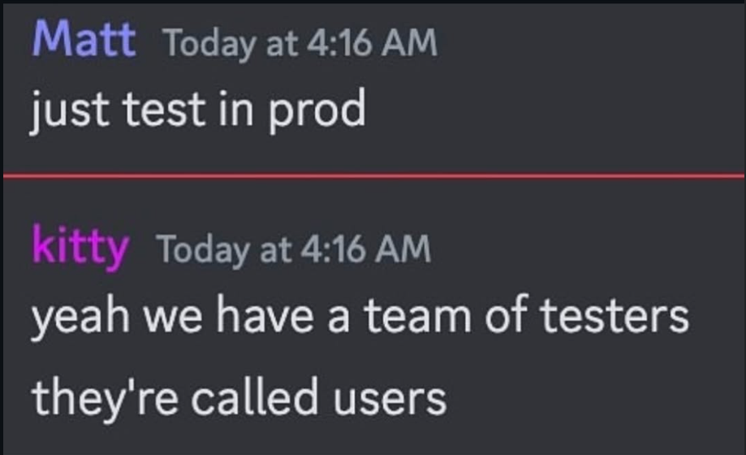

# 12 · Testing strategy

## Who does the testing here?

> **Matt** — just test in prod
>
> **kitty** — yeah we have a team of testers they're called users

Funny anywhere else. Here it is a **description of the system this one replaces**: the prior
system had **zero tests** and verified changes by messaging real people from a real WhatsApp
account (`00-prior-art.md`, M20). The testers were the candidates.

And the stakes are worse than an embarrassing bug. Testing in production on this stack means
sending real messages from a real number — and the number is the asset with no recovery path.
A bad loop does not produce a bug report; it produces a permanent ban with no appeal
(`08-antiban.md`).

So the answer to the question is: **the `fake` adapters do.** With `ChannelProvider` and
`SourceConnector` as ports, the entire pipeline — dispatcher, anti-ban engine, campaigns,
inbox, webhooks — is testable with no phone, no account and no network. That is the bar being
cleared, and it is why the ports exist at all.

## The pyramid

| Layer | Tool | Target | Covers |
|---|---|---|---|
| **Unit** | Vitest | ≥80% core, **100% anti-ban + dispatcher** | Rate maths, warmup curve, jitter distribution, merge policies, phone normalisation, template rendering, identity resolution, risk scoring |
| **Contract** | Vitest + LocalStack, Keycloak, MailHog | Every adapter and every driver | One conformance suite per port — `ChannelProvider`, `SourceConnector`, `StorageDriver`, `AuthProvider`, `QueueDriver`, `EmailDriver`, `KmsDriver`. New adapters are correct by construction; swapping drivers provably changes nothing. |
| **Integration** | Vitest + Testcontainers | Repositories, queues, workers | Real Postgres, real queue, no mocks at the boundary. Migrations up and down. **RLS isolation asserted per table.** |
| **API** | Supertest + Testcontainers | Every endpoint | Happy path, authz matrix (every role × every endpoint), validation, pagination, idempotency, rate limits, error shapes |
| **E2E** | Playwright | Critical journeys | **Built (10 specs):** sign in/out, every page renders, import a CSV and tag it, mass-tag, tag one by hand, build a broadcast (from a tag and from an inline filter), flag do-not-contact, define a custom field, advisory-mode control. **Still to add:** inbox thread flows, the restriction banner (needs seeded state), sending verified in CI (needs a fake-number gateway) |
| **Simulation** | Custom harness | The anti-ban engine | See below |
| **Load** | k6 | Throughput and soak | 10k campaign · 100 msg/s inbound burst · 50k-row import · 24 h soak |
| **Security** | ZAP, Semgrep, gitleaks, Trivy, custom | Every PR | OWASP Top 10, cross-tenant IDOR, SSRF, authz bypass, injection |
| **Chaos** | Scripted | Quarterly | Kill Postgres / queue / gateway mid-campaign |
| **Manual** | Runbook | Pre-release | One real number, small scale, against a checklist |

## The simulation harness — ✅ built

> **Built (2026-10-05):** `npm run test:sim` (files `tests/simulation/*.sim.ts`, config
> `vitest.sim.config.ts`; CI runs it on `main`). It runs the **real** gateway code — `sweepPendingWork`,
> which sends, scores health, dispatches campaigns and fires read receipts and presence noise — against
> `SimulatedWhatsApp`, a `FakeChannelProvider` subclass that scores every send against the documented
> ban heuristics (burst, volume beyond the account's age, night sending, robotic timing, identical
> bodies, strangers who never answered, reply ratio, a flood after reconnect), downgrades deliveries at
> risk 60 and bans at 100. Its thresholds are deliberately independent of, and looser than, the
> engine's own, so the test is not circular. Time is simulated: JavaScript `Date` is faked, and the
> simulation's database connections shadow `now()` with `simclock.now()` (a `search_path` shim that no
> other connection or test sees), so days of traffic run in minutes with the engine none the wiser. The
> people are simulated too — configurable delivery and reply rates, receipts and replies arriving
> through the real `applyDeliveryStatus` / `storeInboundMessage`. A **negative control** drives a number
> with every protection off and asserts it *is* banned, so a harness gone blind cannot pass quietly.
> Scenarios built: day-1 blast (to strangers, and to known contacts), a warmed number's long campaign
> (ceilings, never at night, human timing), reconnect-then-backlog, and the low-reply-ratio spiral.
> **Scaled down** from the table below (hundreds of recipients, 2–4 days, not 10k) so it runs in
> minutes. Not built: the "5 workers, one sender" scenario — the gateway holds exactly one connection
> per number by design, so concurrent workers on one sender is not a supported topology.
> **It found two real bugs on its first run**, both fixed: a healthy number's first burst of sends was
> read as a delivery collapse (sends too fresh to have a receipt counted as undelivered) and opened a
> 48 h soft-ban pause; and a backlog drained at full speed the instant the socket returned.
> The original design follows.

**The single highest-value test in the project**, because it is the only way to validate
`08-antiban.md` without risking a real number.

`tests/simulation/` implements a **virtual WhatsApp** that enforces the documented ban
heuristics and bans you when you trip them:

- tracks reply ratio, block rate, contact-graph distance, send timing regularity, body
  similarity, burst-after-reconnect
- issues typed failures the engine must handle: 401, 403, 429, 463, and delivery collapse
- **bans the virtual number** when the weighted signal crosses the documented threshold

Scenarios run in CI on `main`:

| Scenario | Assertion |
|---|---|
| Cold number, day-1 10k blast | Engine caps at the warmup ceiling; never banned |
| 10k campaign over a warmed number | Completes; never banned; never exceeds documented limits |
| Reconnect then burst | No flood after reconnect |
| Low-reply-ratio spiral | Engine brakes before the simulation downgrades quality |
| Silent restriction (deliveries stop, nothing errors) | Noticed from delivery evidence; the number is held; its campaign is paused; sends stop |
| Restriction that heals | Returns to `ok` once delivery is normal and the old evidence ages out; the timeline shows suspected → easing → cleared |
| A third of phones simply off | Never flagged — the detector does not cry wolf |
| 5 workers, one sender | Shared budget respected; no double-spend |
| Timing distribution over 1,000 sends | Gaussian; no detectable fixed period |

The engine must trip **its own** circuit breakers before the simulation trips its ban
heuristics. If the simulation ever bans us, that is a build failure.

## Regression tests for prior defects

Every `M*` in `00-prior-art.md` gets a named regression test. The highest-value ones:

| Defect | Test |
|---|---|
| M7 empty-string dedup | Two blank-email contacts stay two contacts |
| M8 unnormalised phones | Five formats of one number resolve to one contact |
| M9 blind overwrite | Sparse re-import destroys nothing |
| M11 caps counted rounds | Cap counts messages, including agent replies |
| M12 send path bypass | No route or job can reach a provider except via the dispatcher |
| M13 in-process state | Multi-worker run produces correct shared-budget behaviour |
| M26 poison message | One unresolvable recipient does not affect the session or other sends |
| M31 context bleed | Two conversations with one contact stay separate |

## Preset and resource testing

- **E2E runs on all three presets** — `lean`, `standard`, and a paid-equivalent (LocalStack S3
  + KMS + SES, Keycloak OIDC). A test passing on one and failing on another means the
  abstraction leaked, and the build fails.
- **`lean` is the preset that must never break** — it is the default and what most self-hosters
  will run.
- **Resource budget as a test**: a CI job runs `lean` under a hard **2 GB memory limit** with a
  synthetic Solo-tier workload and fails on OOM or on exceeding the documented footprint by
  more than 20%. This keeps `19-capacity.md` honest and stops the default quietly growing past
  the box it promises to fit.

## Test data

**Synthetic only** (M19 — the old repo committed a real-looking candidate record with name,
mobile, DOB, address and salary). A fixture library builds orgs, contacts and conversations
deterministically from a seed, so failures reproduce exactly.

A deliberately hostile ingestion fixture is maintained as a first-class asset: mixed date
formats, `19 Year(s) 0 Month(s)`, lakh/crore salaries, duplicate emails, blank emails, phones
in five formats, non-UTF8 bytes, 50k rows.

## What runs on every pull request (GitHub Actions)

Four checks appear on a PR. They are the same things `npm run verify` runs locally, split so a failure points
at one cause. Workflows: `.github/workflows/ci.yml` and `.github/workflows/simulation.yml`.

| Check | Time | What it does | What a failure means |
|---|---|---|---|
| **ci / check** | ~2 min | Starts a real Postgres, migrates the test database, runs typecheck (API and web), lint (including the "every function has a comment saying why" rule), the whole vitest suite (unit, contract, integration, the RLS isolation tests), and re-applies the migrations to prove they are idempotent. | The code does not compile, breaks a rule, a behaviour regressed, or a migration is not safe to re-run. |
| **ci / e2e** | ~2 min | Builds the schema, creates the e2e admin and seeds the test org, starts the API, the gateway on the in-memory fake channel, and the web app, then drives a real Chromium through the browser specs: login and logout, inbox, contacts and tags, import, broadcasts, do-not-contact, numbers, saved audiences, and a message sent end to end. | A screen or flow a person uses is broken, even though the unit tests pass. |
| **ci / secrets-scan** | ~10 s | Runs gitleaks over the diff for API keys, tokens and private keys. The CI-only throwaway keys are marked `gitleaks:allow`. | A secret was about to be committed. Remove it and rotate it; deleting the commit is not enough. |
| **simulation / simulate** | ~4 min | Runs nine scenarios (a day-one blast, a warmed long campaign, a reconnect backlog, a reply-ratio spiral, silent restrictions and more) through the real anti-ban engine against a virtual WhatsApp that scores every send and bans when it is misbehaved with. | The engine now sends in a pattern the model would ban, or a restriction goes unnoticed. This is the check that protects the number. |

Notes:
- All four are required to be green before merge; none of them can touch a real WhatsApp number.
- The simulation is a *model* of WhatsApp, not WhatsApp. Passing it does not prove the thresholds are right on
  the real service; only the real-number pilot does (D-34).
- Locally, `npm run verify` runs the same stages plus a scripted no-send flow (see
  [`24 · Local testing`](24-local-testing.md)). `npm run test:live` is the only thing that uses a real number
  and it is never part of CI.

## Gates

| Stage | Must pass |
|---|---|
| **PR** | lint (incl. the JSDoc rule) · typecheck · unit · contract · integration · API · Semgrep · gitleaks |
| **main** | + E2E on all presets · simulation · resource budget |
| **Release** | + load · chaos · restore drill · manual checklist |

## Coverage

≥80% on `core`, `ingestion`, `channels`. **100% on `antiban` and the dispatcher** (NFR-22) —
these are the components where a gap is a banned number or a duplicate send, not a bug report.

Coverage is a floor, not a goal. A PR that raises coverage while testing nothing meaningful is
a review failure.
