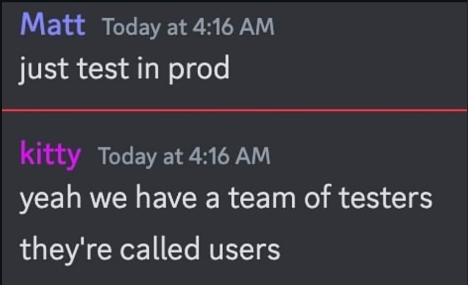

# 12 · Testing strategy

## Who does the testing here?

> **Matt** — just test in prod
>
> **kitty** — yeah we have a team of testers they're called users

Funny anywhere else. Here it is a **description of the system this one replaces**: the prior
system had **zero tests** and verified changes by messaging real people from a real WhatsApp
account (`00-prior-art.md`, M20). The testers were the candidates.

And the stakes are worse than an embarrassing bug. Testing in production on this stack means
sending real messages from a real number — and the number is the asset with no recovery path.
A bad loop does not produce a bug report; it produces a permanent ban with no appeal.

So the answer to the question is: **the `fake` adapters do.** With `ChannelProvider` and
`SourceConnector` as ports, the entire pipeline — dispatcher, anti-ban policy, campaigns,
inbox, webhooks — is testable with no phone, no account and no network. That is the bar being
cleared, and it is why the ports exist at all.

## The pyramid

| Layer | Tool | Target | Covers |
|---|---|---|---|
| **Unit** | Vitest | ≥80% core, **100% anti-ban policy + dispatcher** | The anti-ban policy, schedule, ticks, decrypt retries and opt-out rules (`packages/core/src/antiban/*.test.ts`), merge policies, phone normalisation, template rendering, identity resolution |
| **Contract** | Vitest + LocalStack, Keycloak, MailHog | Every adapter and every driver | One conformance suite per port — `ChannelProvider`, `SourceConnector`, `StorageDriver`, `AuthProvider`, `QueueDriver`, `EmailDriver`, `KmsDriver`. New adapters are correct by construction; swapping drivers provably changes nothing. |
| **Integration** | Vitest + Testcontainers | Repositories, queues, workers | Real Postgres, real queue, no mocks at the boundary. Migrations up and down. **RLS isolation asserted per table.** |
| **API** | Supertest + Testcontainers | Every endpoint | Happy path, authz matrix (every role × every endpoint), validation, pagination, idempotency, rate limits, error shapes |
| **E2E** | Playwright | Critical journeys | **Built (11 specs):** sign in/out, every page renders, import a CSV and tag it, mass-tag, tag one by hand, build a broadcast (from a tag, on the New campaign screen: review panel, fill-in table, draft), flag do-not-contact, define a custom field, the Contacts screen (pick a file, search, Filters with a live count, Select all N, Add tag and Undo, saved lists, Columns, the person panel). The Import screen has its own specs (`tests/e2e/import-*.spec.ts`: flow with a required tag, problems, re-upload, notice and reset, keep columns, looking through the sheet). **Still to add:** inbox thread flows, sending verified in CI (needs a fake-number gateway) |
| **Load** | k6 | Throughput and soak | 10k campaign · 100 msg/s inbound burst · 50k-row import · 24 h soak |
| **Security** | ZAP, Semgrep, gitleaks, Trivy, custom | Every PR | OWASP Top 10, cross-tenant IDOR, SSRF, authz bypass, injection |
| **Chaos** | Scripted | Quarterly | Kill Postgres / queue / gateway mid-campaign |
| **Manual** | Runbook | Pre-release | One real number, small scale, against a checklist |

## WhatsApp, failures and mistakes

The parts that break in real use (linking, the connection, sending) are tested at three levels.

| Level | Where | What it proves | Needs a person |
|---|---|---|---|
| **Replay** | `tests/contract/baileys-replay.test.ts` | The real WhatsApp adapter, fed the event sequences WhatsApp produces through a scripted socket (`tests/fixtures/baileys-socket.ts`): QR, QR timeout, scan and the 515 restart, pairing code, 401 device removed, 403 ban, 408, 428, 440 taken elsewhere, giving up after five reconnects from WhatsApp's side, no internet for 20 minutes without giving up, a restart restoring the number, sending, refusals, inbound, ticks. Runs in CI. | No |
| **Contract** | `tests/contract/baileys-channel.test.ts` | The same conformance suite the fake passes, run on the real adapter, so the fake cannot drift from it. | No |
| **Failure modes** | `tests/integration/failure-modes.test.ts` | The gateway and API with a real database: the connection dropping before and during a send, the gateway killed mid-campaign, the database going away after WhatsApp accepted a message, two Starts at once, unlink and relink, ban, and what a person gets wrong (Cancel, Pause on a draft, blank messages, removed numbers, Link pressed three times). The rule they hold the code to: nobody is messaged twice, nobody in a campaign is lost without a reason shown, and work carries on when the number is back. | No |
| **Live suite** | `npm run live:suite` (`tests/live/live-suite.ts`, groups `inbox`, `campaign`, `ai`, `interest`, `optout`) | Number A in the install, number B on the standalone tester (`tests/live/tester.mjs`): a message in, a reply out, a campaign once, Cancel, Pause on a draft, the AI's answers (salary kept general, nothing internal, injection refused), whether the AI files a yes as interested and a no as not interested, STOP and START. Run the groups one after another, never together (they share B). Steps and settings: [`48`](48-live-test-playbook.md). | Once: link both numbers |
| **Live canary** | `npm run live:canary` (`scripts/live-canary.ts`) | Two spare numbers in one install: A sends to B, B sees it, B replies, A sees it, with the delivered tick both ways. `--check` only lists what a person still has to do. Run from cron every few hours; `CANARY_ALERT_URL` posts a failure to Slack or Discord. Exit 0 healthy, 1 failed, 2 not ready. | Once: two spare numbers, each linked with a QR scan |

A known bug that is not fixed yet is a test marked `it.fails` with its `[R-nnn]` tag: it passes while the bug is there and fails the run the day it is fixed, so the marker and the registry row get updated together. In the shared contract suite, an adapter lists its open bugs in `knownBugs`.

What only a person can check: the message on phone B's screen (the canary sees the tick, not the screen), and removing the device under Linked devices on the phone to see the Numbers page say so and the campaigns pause.

## Organisations, roles and several people at once (2026-11-10)

| Where | What it proves |
|---|---|
| `tests/integration/org-harness.ts` | Shared set-up: two organisations, admins, agents, a disabled person, a key per scope, revoked and expired keys, one of everything per organisation |
| `tests/integration/orgs-roles-matrix.test.ts` | Every route against every kind of caller (admin, agent, each key scope, bootstrap key, nobody); access changes mid-session; passwords, lockout, bad input |
| `tests/integration/orgs-isolation.test.ts` | One organisation reaching another's data by id, by list, inside creates, and through the database wall; same names in both |
| `tests/integration/shared-template-campaign.test.ts` | Several people on one template, campaign, tag, reply and contact at the same moment |
| `tests/integration/orgs-modules.test.ts` | **Written 2026-11-11, not run yet** (66 tests; skipped unless `RUN_ORG_MODULES=1`, until a person has run it once). The modules the first runs did not reach: contact export (admin only, audited, five an hour), API keys (secret shown once, per organisation), key rotation and encryption status, campaign pictures and downloads, imports in two organisations, segments and custom fields (including two admins at once), the audit trail, and chat presence. Each test states the correct behaviour; a failure is a new bug or a wrong assumption, to be decided when it is first run. ENC-7 pins SEC-8 as a decision |
| `tests/e2e/orgs-and-roles.spec.ts` | The same cast through the screens (48 tests; the last 9, SCR-1 to SCR-9, are written and not run yet: Security, Linked numbers, Export, Billing, Import and Segments by role, sign-out in two tabs, and the sign-up page, which is a front-end mock that creates nothing): sign-in per role, admin-only screens, isolation, two browser sessions on one campaign, widths 375 and 1280. Needs its own stack and database (`E2E_BASE_URL`, `E2E_API_URL`, `E2E_BOOTSTRAP_KEY`, `E2E_DATABASE_URL` with "e2e" in its name; it refuses a live database) |

Known bugs here are `it.fails` (API) or `test.fail` (browser): X-002 to X-004 in [`49`](49-bug-list.md). The live two-organisation runs (real phones, scripts outside the repo) are logged in [`47`](47-live-test-log.md).

## Regression tests for prior defects

**Bugs found after launch** (reported by a tester, found by the audit, caught in CI) have their own system: the **regression registry** `tests/regression/REGISTRY.md`, where every bug gets an R-number and a test with `[R-nnn]` in its title, a bug-fix gate in CI, a production-build smoke run on every PR and a nightly full run. The whole flow, from report to merge, is in [`39-bug-workflow.md`](39-bug-workflow.md) and the mechanics are in [`tests/regression/README.md`](../tests/regression/README.md). The table below is the older list of defects from the previous system (`M*` in `00-prior-art.md`).

Every `M*` in `00-prior-art.md` gets a named regression test. The highest-value ones:

| Defect | Test |
|---|---|
| M7 empty-string dedup | Two blank-email contacts stay two contacts |
| M8 unnormalised phones | Five formats of one number resolve to one contact |
| M9 blind overwrite | Sparse re-import destroys nothing |
| M11 caps counted rounds | Cap counts messages, including agent replies |
| M12 send path bypass | No route or job can reach a provider except via the dispatcher |
| M13 in-process state | Multi-worker run produces correct shared-budget behaviour |
| M26 poison message | One unresolvable recipient does not affect the session or other sends |
| M31 context bleed | Two conversations with one contact stay separate |

## The Inbox screen

- `tests/integration/inbox-list.test.ts` (needs a database): search by name, number and last message, the quick views and their counts, filters, paging, the person panel's fill-ins, and the campaign of each message.
- `tests/integration/thread-lock.test.ts` and `participants.test.ts`: only the owner or an admin may send (a participant may read, not reply), and the first sender in an unowned chat becomes its owner.
- `apps/web/lib/inbox-format.test.ts`: list times, search highlight and snippet, campaign dividers, reply fill-ins.
- Playwright: `seeded-pages.spec.ts` (Filters, a note, Resolve and Reopen from Details), `ai-notice.spec.ts`, `zz-roles-flow.spec.ts` (presence and typing are read from the API, the Inbox no longer prints them).

## Preset and resource testing

- **E2E runs on all three presets** — `lean`, `standard`, and a paid-equivalent (LocalStack S3
  + KMS + SES, Keycloak OIDC). A test passing on one and failing on another means the
  abstraction leaked, and the build fails.
- **`lean` is the preset that must never break** — it is the default and what most self-hosters
  will run.
- **Resource budget as a test**: a CI job runs `lean` under a hard **2 GB memory limit** with a
  synthetic Solo-tier workload and fails on OOM or on exceeding the documented footprint by
  more than 20%. This keeps `19-capacity.md` honest and stops the default quietly growing past
  the box it promises to fit.

## Test data

**Synthetic only** (M19 — the old repo committed a real-looking candidate record with name,
mobile, DOB, address and salary). A fixture library builds orgs, contacts and conversations
deterministically from a seed, so failures reproduce exactly.

A deliberately hostile ingestion fixture is maintained as a first-class asset: mixed date
formats, `19 Year(s) 0 Month(s)`, lakh/crore salaries, duplicate emails, blank emails, phones
in five formats, non-UTF8 bytes, 50k rows.

## What runs on every pull request (GitHub Actions)

Three checks appear on a PR. They are the same things `npm run verify` runs locally, split so a failure points
at one cause. Workflow: `.github/workflows/ci.yml`.

| Check | Time | What it does | What a failure means |
|---|---|---|---|
| **ci / check** | ~2 min | Starts a real Postgres (and an S3 emulator, moto, for the storage contract suite), migrates the test database, runs typecheck (API and web), lint (including the "every function has a comment saying why" rule), the whole vitest suite (unit, contract, integration, the RLS isolation tests), and re-applies the migrations to prove they are idempotent. | The code does not compile, breaks a rule, a behaviour regressed, or a migration is not safe to re-run. |
| **ci / e2e** | ~2 min | Builds the schema, creates the e2e admin and seeds the test org, starts the API, the gateway on the in-memory fake channel, and the web app, then drives a real Chromium through the browser specs: login and logout, inbox, contacts and tags, import, broadcasts, the campaigns list, the campaign page and its chat panel, do-not-contact, numbers, saved audiences, and a message sent end to end. | A screen or flow a person uses is broken, even though the unit tests pass. |
| **ci / secrets-scan** | ~10 s | Runs gitleaks over the diff for API keys, tokens and private keys. The CI-only throwaway keys are marked `gitleaks:allow`. | A secret was about to be committed. Remove it and rotate it; deleting the commit is not enough. |

Notes:
- All three are required to be green before merge; none of them can touch a real WhatsApp number.
- Locally, `npm run verify` runs the same stages plus a scripted no-send flow (see
  [`24 · Local testing`](24-local-testing.md)). `npm run test:live` is the only thing that uses a real number
  and it is never part of CI.

## Gates

| Stage | Must pass |
|---|---|
| **PR** | lint (incl. the JSDoc rule) · typecheck · unit · contract · integration · API · Semgrep · gitleaks |
| **main** | + E2E on all presets · resource budget |
| **Release** | + load · chaos · restore drill · manual checklist |

### Anti-ban v2 tests

One test per acceptance case of [F6](06-features/F6-antiban.md), titled with its number (`AC-1.3 ...`): unit tests next to the code in
`packages/core/src/antiban/` and in the Baileys adapter (`notices.test.ts`, `profile-session.test.ts`); integration tests
`tests/integration/antiban-v2-{lane,schedule,warnings,protection,ticks,decrypt,optout,api}.test.ts` on real Postgres and the fake provider, with the
shared `antiban-v2-harness.ts`, which injects the clock, the random draw and the sleep so a 30-minute tick check or a 90-second silence runs in
milliseconds. `antiban-purged.test.ts` fails if a name of the removed first engine comes back. S10 has no test yet (it is not built).

## Coverage

≥80% on `core`, `ingestion`, `channels`. **100% on `antiban` and the dispatcher** (NFR-22) —
these are the components where a gap is a banned number or a duplicate send, not a bug report.

Coverage is a floor, not a goal. A PR that raises coverage while testing nothing meaningful is
a review failure.
