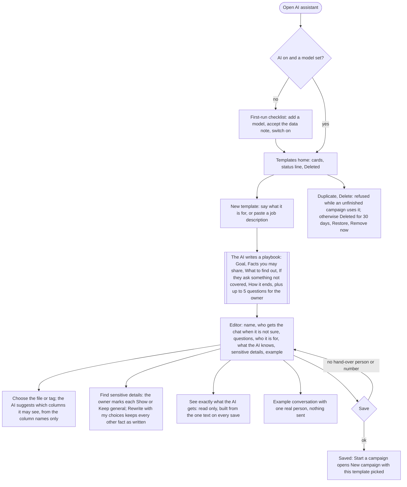
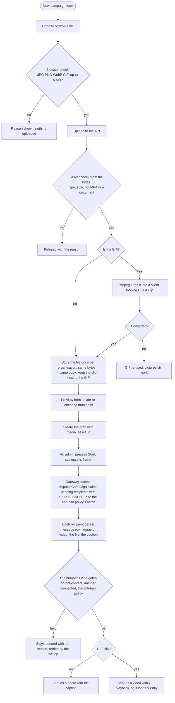
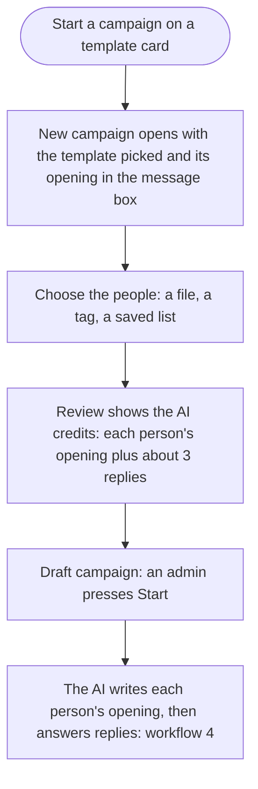
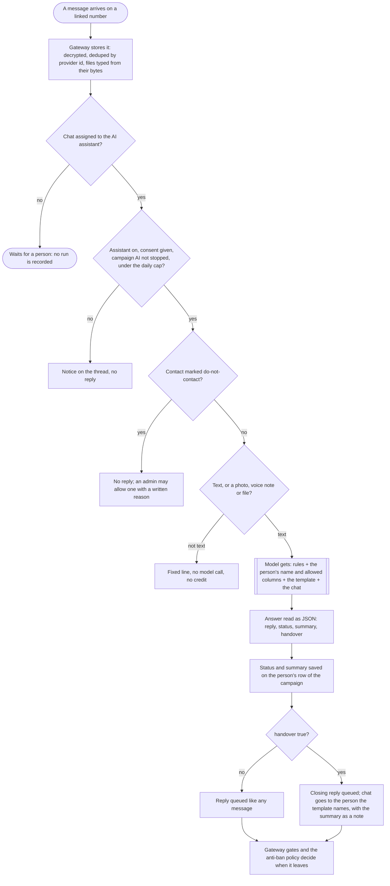
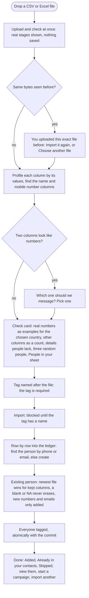
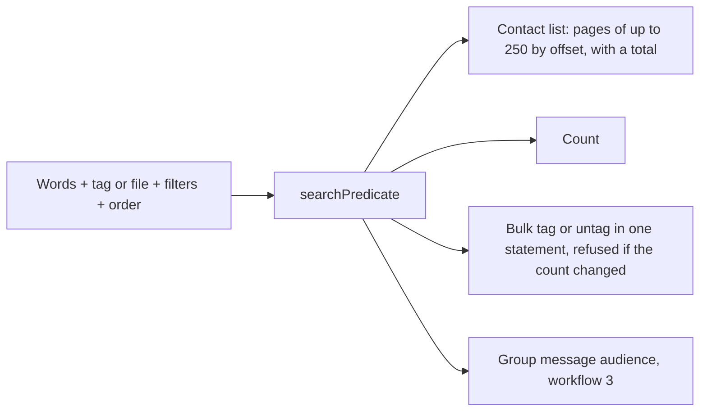
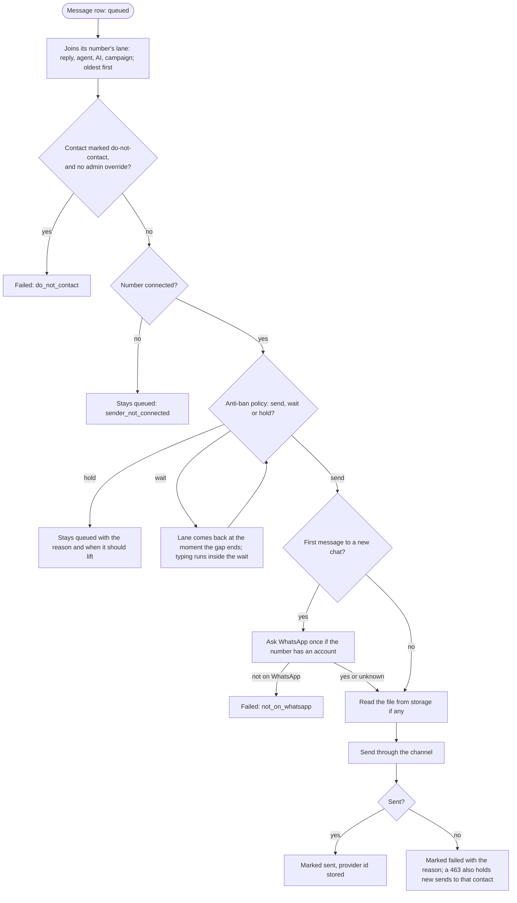
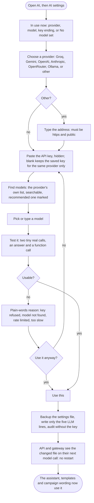

# 36 · Workflows

How the main things work, as diagrams. Written 2026-10-21 from the code as built (what is **not** built is
marked). The diagrams are [Mermaid](https://mermaid.js.org): they draw themselves on GitHub and in most Markdown
viewers. Legend: rounded boxes are steps, diamonds are decisions, the shaded boxes are the AI model.

## 1 · AI templates: the Templates home and the editor

`/ai` is the Templates home (cards, a status line, a first-run checklist when the AI is not on yet); `/ai/new` and `/ai/t/<id>` are the editor; the AI provider is the second tab, `/ai/settings`.
(Code: `apps/web/app/ai/`, `packages/core/src/ai-templates.ts`, `ai-example.ts`.)

**What the AI is told when it replies** (every time, in this order): who it writes for and how (a member of the organisation's
team, never "an assistant"; one short message and one question per turn), how to run the conversation to its end, the
**always-on rules** (locked, added in `systemText` so editing cannot remove them), what is known about this person (their name and
the columns the template allows), the answer format, then the template's instructions. The customer's messages are only ever
conversation turns. The description the owner typed is never sent to the reply model.

**What the AI answers with:** one JSON object, `reply` (the only text sent), `status`, `summary` and `handover`.

## 2 · A campaign with a picture or GIF

(Code: `packages/core/src/campaign-media.ts`, `media-convert.ts`, `campaigns.ts`, `apps/gateway/src/work.ts`,
`packages/channels/baileys/src/outbound-content.ts`.)

## 3 · Start a campaign from a template

The Templates home and the editor open New campaign with the template picked (`/broadcast/new?template=<id>`). The template's draft opening
goes into the message box and can be changed there; the audience is chosen on New campaign. The campaign keeps `ai_template_id`.
(Code: `apps/web/app/broadcast/new/`.)

## 4 · An inbound message answered by the AI assistant

(Code: `packages/core/src/ai-reply.ts`, `ai-turn.ts`, `apps/gateway/src/main.ts`.) Only chats **assigned to the assistant** are answered; a campaign reply in a chat nobody owns is given to it.

The AI finishes a conversation only after a recap the person confirmed, a clear no, or a request for a person. Having the person's
contact details, or not knowing one answer, does not end it.

## 5 · Importing contacts

(Code: `apps/web/app/import/`, `apps/web/lib/import.ts`, `packages/core/src/ingestion.ts`. The rules for rows and for importing a file again are in [`07-ingestion.md`](07-ingestion.md).) The extra columns are stored as one JSON object on the contact (`contact.custom_fields`, a `jsonb` column with a search index, docs/35), not as a database column each, so any number of sheet columns fit.

## 6 · One search rule for the list, the count and bulk tagging

## 7 · The send pipeline for every outbound message

All sends, text or picture, human or AI or campaign, end here. (Code: `runLane` in `apps/gateway/src/lane.ts`, started by `handleSend` and the sweep in `work.ts`;
the rules are in [`08-antiban.md`](08-antiban.md).)

The policy (`makeAntiBanPolicy`) is pure: it reads the number's state, the contact's state, the stored gap and the clock, and answers send, wait or hold. A message that has to wait does not block one that is held for a different reason (a new chat held by a timelock lets a known contact through), but it does hold up the lane behind it.

## 8 · Choosing the AI: the AI settings tab

Second tab inside the AI tab, `/ai/settings`. (Code: `apps/web/app/ai/settings/`, `apps/api/src/routes/ai.ts`, `packages/providers/llm/src/`.) Admin only.

## AI campaigns: who writes the first message

A campaign made from an AI template (a template card's "Start a campaign", or "Use a template" on New campaign) does not send its typed text. The gateway asks the AI to write one opening per person from the template's instructions, the person's name and the columns the template allows, and the typed text as an outline. The opening is at most two short sentences and under 220 characters, from the organisation, never from "an assistant". Only people with an opening are queued, and the AI's text is what goes out; the rest of the pipeline (the anti-ban policy, do-not-contact) is unchanged. If the AI is off, or no model is set, those campaigns wait. After three failed writes a person is skipped as `ai_opening_failed`. Code: `packages/core/src/ai-opening.ts`, `dispatchCampaign`, `apps/gateway/src/work.ts`.
