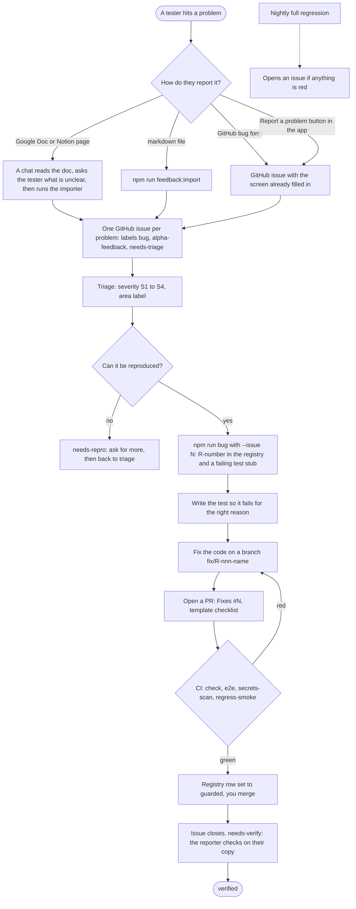

# 39 · From a bug report to a merged fix

How a problem a person hits becomes a fix that is guarded by a test and merged. Short version: **report → triage → issue → R-number and a failing test → fix → PR → CI → merge → verify**. The regression framework itself is described in [`tests/regression/README.md`](../tests/regression/README.md); this page is the human flow around it.

## If you are a new chat session: handling a bug report, in 8 lines
1. Read this page and `tests/regression/README.md`. The commands: `npm run bug`, `npm run regress:check`, `npm run regress`, `npm run feedback:import`, `npm run feedback:report`, `npm run changelog`.
2. A report arrives as a Google Doc / Notion page, a markdown file, a GitHub issue or a pasted message. **Ask the reporter about anything unclear before touching code.** Never commit their screenshots or real names and numbers (the repo is public).
3. Make or find the GitHub issue (`feedback:import` for a file; for a doc, read it with the Drive connector and create one issue per problem). Set a severity label and an `area:` label.
4. `npm run bug -- "<what broke>" --found "<who, where>" --issue N`. Write the test so it **fails for the right reason first**.
5. Fix the code on `fix/R-nnn-short-name`. Set the registry row to `guarded` and put the PR number in Fix.
6. Open the PR with `Fixes #N`. CI must pass: check, e2e, secrets-scan, regress-smoke, bug-gate. If a test fails, **look at the failure** (CI keeps the page snapshot and screenshot of a failed browser test); a pass-on-retry is a flaky test, to be fixed or tagged `@flaky`, never ignored.
7. Kushal merges (unless the PR carries the `automerge` label). After the merge the issue gets a "please verify" comment.
8. Refresh the triage doc with `npm run feedback:report -- --batch <name>` and tell Kushal in plain words what is fixed, what is partly fixed and what is open.

## 1 · Reporting (anyone)
- **A Google Doc or Notion page** (use [`feedback/TEMPLATE.md`](feedback/TEMPLATE.md)): paste the screenshot and describe it in your own words. A chat session reads the doc (the Drive connector for Google Docs), **asks you questions about anything unclear**, then creates the issues. Screenshots stay in the doc or on the laptop; they are never uploaded to GitHub or committed, because the repository is public and they show real names and numbers.
- **The "Report a problem" button** (bottom of the sidebar): opens the GitHub bug form on the right screen. Nothing is sent until you press submit there.
- **The GitHub bug form** directly (`Issues → New issue → Bug report`).
- **A markdown file** in the format of `dev-feedback-prod-issues.md`: `npm run feedback:import -- <file> --batch <name> --reporter <Name>` (dry run), then `--apply`. Phone numbers and e-mail addresses are masked automatically; use `--redact "a name,another"` for names.

## 2 · Triage (minutes, not days)
Give each issue a severity and an area, and remove `needs-triage`.

| label | meaning |
|---|---|
| **S1** | a wrong message was sent, data was lost, or a number could be banned: fix now |
| **S2** | a feature is broken |
| **S3** | confusing, slow or awkward but it works |
| **S4** | polish |
| `area:` contacts, campaigns, inbox, import, ai, numbers, gateway, team, security, web-ui | where it happens |
| `needs-repro` · `needs-verify` · `verified` · `flaky` | workflow states |

Create or refresh the labels with `bash scripts/setup-labels.sh`.

## 3 · The triage document (generated)
`npm run feedback:report -- --batch <name>` writes `docs/feedback/<name>.md`: every item with its severity, area, status (reported → triaged → reproduced → fixed → verified), R-number, PR and whether a test guards it. It is built from the GitHub issues and the registry, so it is never out of date by hand-editing.

## 4 · Reproduce, then give it an R-number
`npm run bug -- "what broke, in plain words" --found "who, where" --issue 42 [--layer e2e|integration]`. It adds the next R-number to [`tests/regression/REGISTRY.md`](../tests/regression/REGISTRY.md) (with the issue number), writes a skipped test stub, and comments the R-number on the issue.

## 5 · Fix
1. Make the stub test **fail for the reason the bug exists** (keep `[R-nnn]` in its title; add `@smoke` only if it must also run on a production build in CI).
2. Fix the code on a branch named `fix/R-nnn-short-name`.
3. Set the registry row to `guarded` and put the PR number in the **Fix** column.
4. Open the PR with `Fixes #42` in the description.

## 6 · CI and merge
The PR must pass `check` (typecheck, lint, unit and integration tests), `e2e`, `secrets-scan` and `regress-smoke` (a production-build smoke set). `npm run regress:check` also fails if a guarded bug has no test. Kushal merges. After the merge the issue closes; ask the reporter to confirm on their copy and add `verified`.

## What is built and what is still to come
Built: labels, issue forms, the in-app button, the importer, the report generator, the registry with its Issue column, the production-build smoke job, the PR template, the bug-fix gate (a fix PR must add a tagged test that guards the bug), the PR's own R-numbers run on a production build with a comment on the PR, and retry-once flaky flagging. After a merge, `after-merge.yml` comments on every issue named by `Fixes #N` and labels it `needs-verify`; `npm run changelog -- --since <date>` lists merged PRs by kind; the opt-in `automerge` label merges a low-risk PR by itself once checks pass. **Not switched on yet:** branch protection and auto-merge are repository settings, applied once on purpose with `bash scripts/protect-main.sh` (shows what it will do and asks). **Nightly:** `.github/workflows/regression-nightly.yml` runs the whole browser suite on a production build at 02:00 India time (and on demand from the Actions tab), with `@flaky` tests included. Red → one issue "Nightly regression failed" (updated, not duplicated; closed when green again); tests that passed only on a retry → one issue "Flaky tests (auto)". **`@flaky` quarantine:** put `@flaky` in a test's title and it leaves every blocking run (PR checks and `npm run regress`) until fixed; only the nightly runs it.
