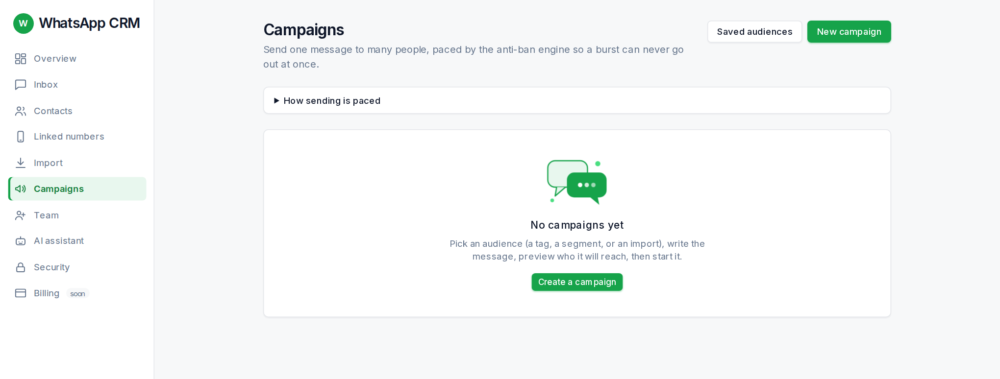
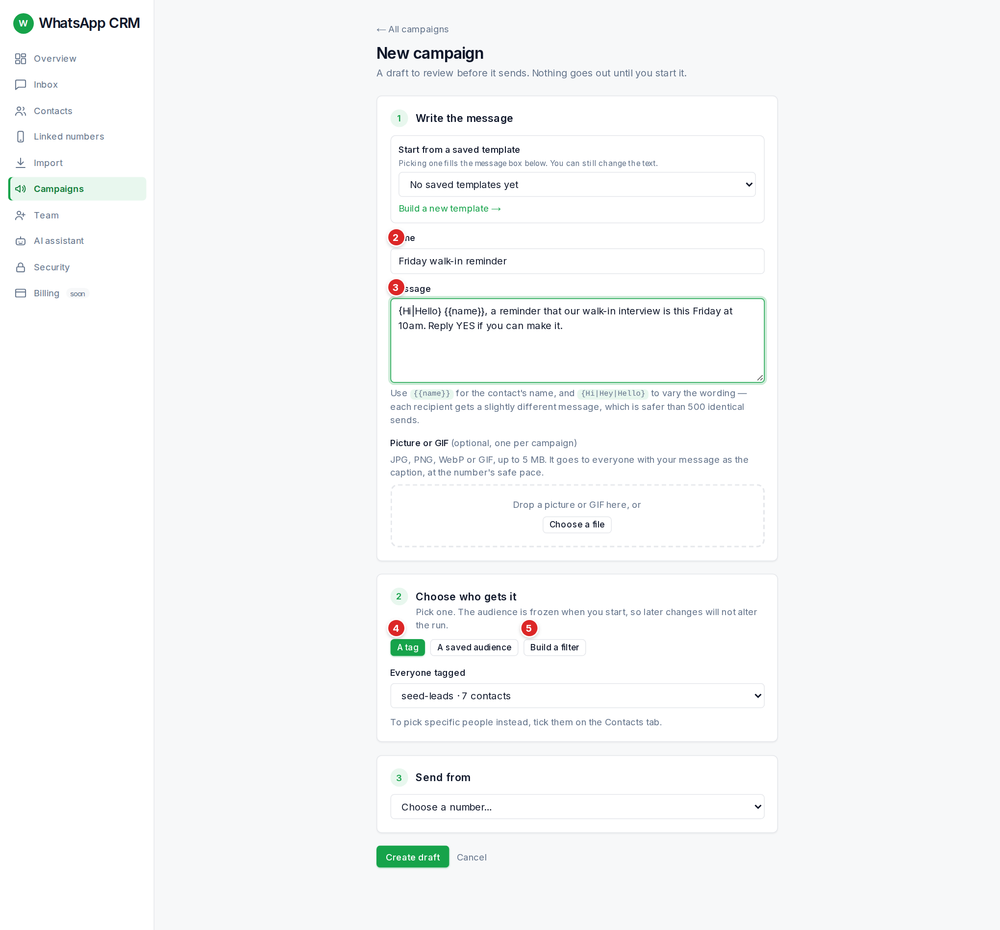
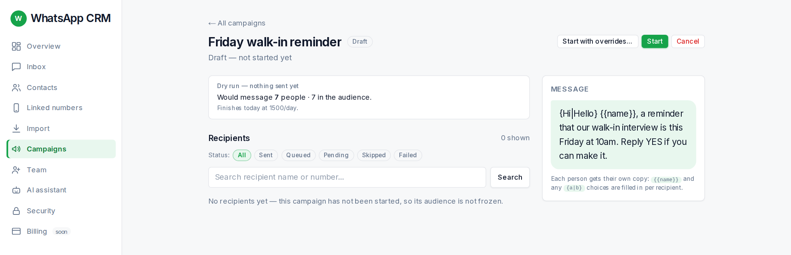

A campaign sends one message to everyone in an audience. It is never instant: the CRM sends at a safe pace and tells you how long it will take.

Campaigns are grouped as **Sending now** (running or paused), **Drafts** and **Finished**. **Saved audiences** (top right) manages reusable audiences, and **How sending is paced** explains the protections.

## Creating a campaign

1.  **Start from a saved template (optional).** The box **Start from a saved template** lists the templates saved on the AI page. Picking one fills the message box; you can still change the text. A template that carries instructions for the AI also makes this an **AI campaign** (see below).
2.  **Write the message.** Use `{{name}}` for the person’s name and `{Hi|Hey|Hello}` to vary wording: each person gets a slightly different message, which is safer than hundreds of identical ones. Custom fields work too, as `{{city}}`.
3.  **Add a picture or GIF (optional).** One JPG, PNG, WebP or GIF per campaign, up to 5 MB. It goes to everyone with your message as the caption, at the same safe pace. A GIF plays as a short looping video. **Use one I uploaded before** reuses an earlier picture.
4.  **Choose who gets it.** Pick exactly one: a tag, an import, a saved audience, or a filter you build (has tag, reply status, "messaged in the last N days"; a live count shows "N people match right now"). The audience freezes the moment you start, so later changes never alter a running campaign. People marked do-not-contact are always left out.
5.  **Send from.** Choose the number.
6.  Press **Create draft**. Nothing is sent yet.

## Checking and starting

A draft shows a **dry run**: "Would message N people · N skipped (no number) · N in the audience", and a **forecast**, for example "About 3 days to finish at 40/day (number still warming up, so the daily cap is low)". New numbers send few messages a day on purpose and build up over time.

1.  Read the message and the numbers. If nobody is reachable, the page says so: check the tag.
2.  Press **Start**. The audience is frozen and sending begins at the safe pace.
3.  Watch progress: "N of M done" with tiles for **Total, Sent, Queued, Pending, Skipped, Failed**. Click a tile to filter the recipient list.
4.  **Pause** stops sending at once; **Resume** continues. **Cancel** ends it for good (people not yet reached are marked skipped).

## AI campaigns: a first message written for each person

When a campaign uses an AI template (and the AI assistant is on), the AI **writes the opening message for each person** from their name and the columns stored on them, following the template's outline, so no two people get the same text. The campaign waits for the AI. If the AI cannot write one after a few tries, that person is **skipped** with the reason *ai\_opening\_failed*; nobody is dropped silently. When someone replies, the AI answers in that chat under the same template. Read a few of the openings in the recipient list before you start a large campaign.

## Why someone was skipped

Every skipped person is listed with a reason; nobody is dropped silently.

| Reason | Meaning |
| --- | --- |
| marked do-not-contact | They asked not to be messaged. |
| no phone number | The contact has no number. |
| an agent is mid-conversation | A colleague is chatting with them right now. |
| sent a campaign within 14 days | They were messaged recently. |
| in another live campaign | They are already waiting in a running campaign. |
| the AI could not write their opening | An AI campaign only: the AI did not produce a message for this person after several tries. |
| campaign cancelled | The campaign was cancelled before their turn. |

## Automatic pauses

A campaign pauses itself if WhatsApp seems to be limiting the number, or has refused or logged the number out. Open **Linked numbers** before resuming anything.

## Start with overrides *(admin only)*

:::caution
An admin can start a campaign **lifting** some people-protection gates (do-not-contact, an agent mid-conversation, the 14-day cooldown, a duplicate campaign) with a written reason of at least 10 characters. The daily limits, pacing and warm-up still apply and cannot be lifted by anyone. Messaging people who asked you to stop is the quickest way to get a number reported and banned.
:::

## Saved audiences

Under **Campaigns → Saved audiences** you can name a filter once and reuse it. Fill in the name, choose **Has tag**, **Reply status** and **Contacted within (days)** (all conditions must match; "any" drops a condition), press **Preview count**, then **Save segment**. A saved audience is re-evaluated each time and freezes when a campaign starts.
