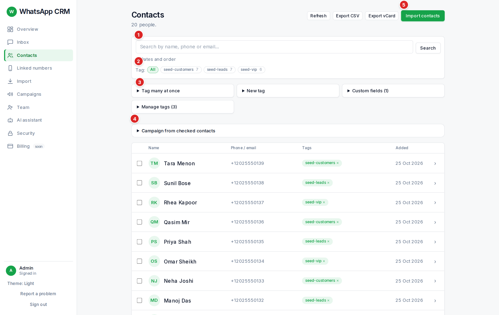

The list shows the first 50 matches. Use search, tags and the **Dates and order** section to narrow it (by when people were added or last imported, and newest, oldest or A–Z).

## Opening a person

Click a row to open it. You can see when they were added and last imported, add or remove tags (**\+ tag…** then **Add**), edit custom fields (**Save fields**) and mark the person **Do not contact** (**Allow contact** reverses it).

:::caution
**Do not contact** means: never message this person. Replies and campaigns skip them. Use it for anyone who asks to stop. Only an admin can knowingly override it for one message or one campaign, with a written reason that is saved.
:::

## Tags

A tag is a label such as "pune" or "interview-stage". Add one person at a time by opening their row, add many people at once with **Tag many at once** (choose **Add tag** or **Remove tag**, pick the tag and who it applies to, press **Preview**, then **Confirm**), or create a new tag in **New tag**. Tags are how you pick campaign audiences, so tag people as you go.

## Custom fields

**Custom fields** are extra columns of your own (text, number, date or a pick-list), for example "City". *(admin only)* Admins add and remove them. Anything you add can be used in a campaign as `{{city}}`.

## Making a campaign from people you ticked

Tick people in the list, open **Campaign from checked contacts**, type a name and message, choose the number and press **Create draft from checked**. People marked do-not-contact cannot be ticked.

## Exporting *(admin only)*

Admins see **Export CSV** and **Export vCard**. Every export is recorded.
