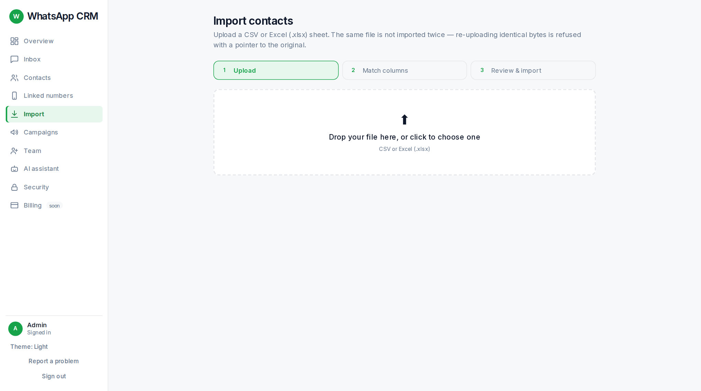
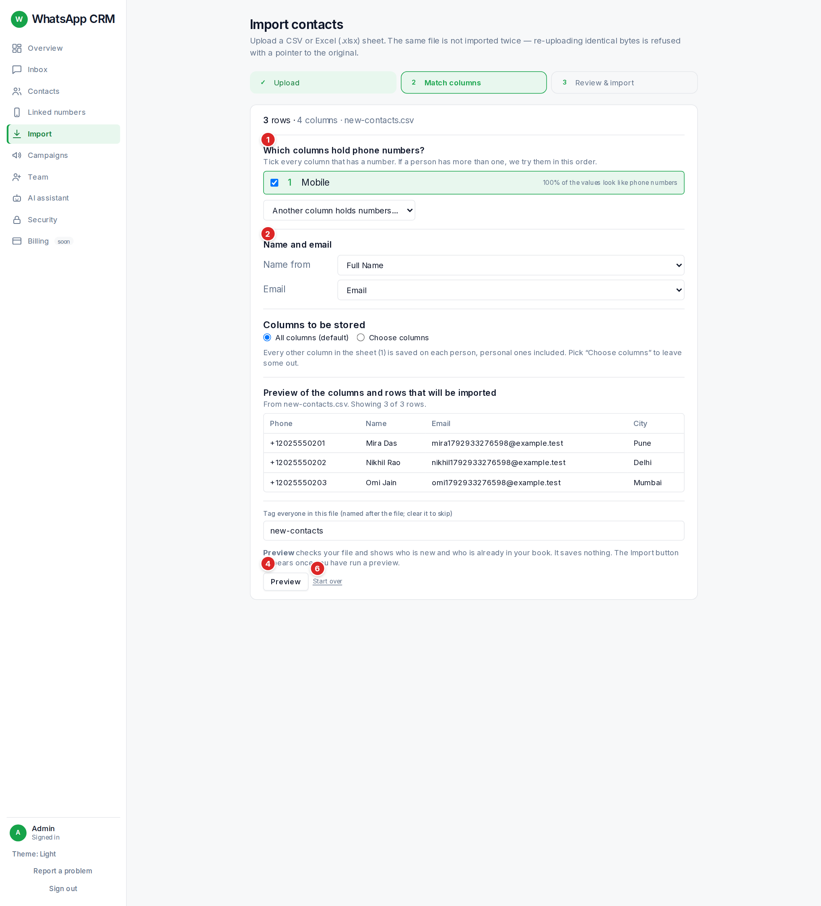
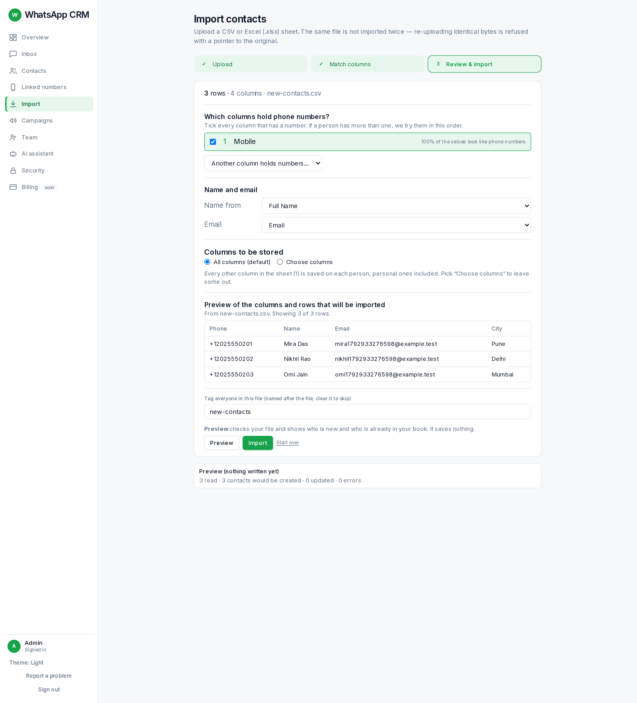

The import wizard takes a CSV or Excel (.xlsx) sheet and turns it into contacts. It works in three steps: **Upload**, **Match columns**, **Review & import**.

## Step 1 · Upload

Drop your file on the box, or click it to choose one. It uploads straight away; there is no Upload button.

-   Your sheet needs a **header row** on top and at least one person underneath.
-   The **same file cannot be imported twice**. If you upload identical bytes again you are told so, and an **Upload anyway** button lets you start a fresh import (people already in the CRM are matched by phone or email and updated, not duplicated).

## Step 2 · Match columns

Columns you do not map are **not thrown away**: by default every column of the sheet is stored on the person (up to 200 columns), and **Choose columns** lets you keep only some.

The phone column is the only required one: someone you cannot reach by number is not a contact. The CRM also guesses the phone column from the values, so it is usually already ticked.

The **Tag everyone in this file** box is filled with the file’s name. Keep it (every imported person gets that tag, which makes them easy to find later) or clear it to skip tagging.

## Step 3 · Preview, then import

1.  Press **Preview**. You see: "N read · N contacts would be created · N updated · N errors".
2.  If a row has a bad number you get a **Rows to fix** box. Those rows are left out of the import. Press **Download these rows (CSV)**, fix them in your sheet and upload again.
3.  Press **Import**. You see "✓ Imported".
4.  Choose what next: **View the N imported contacts** or **Message these people** (starts a campaign for exactly this import).

:::tip
Pressing **Import** before **Preview** shows a red note under the buttons asking you to preview first. If you leave the page halfway and come back, the wizard remembers where you were; once an import has finished, coming back starts fresh.
:::
