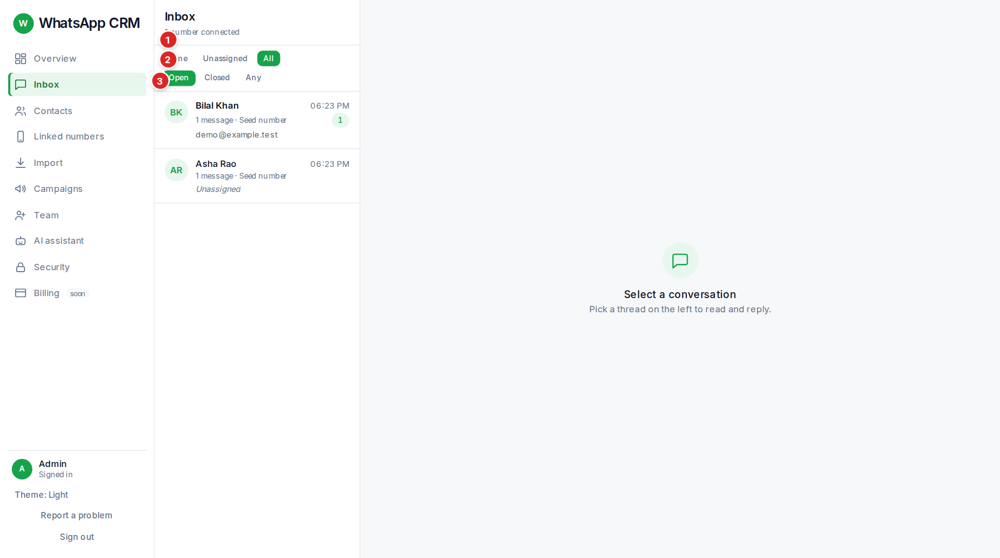
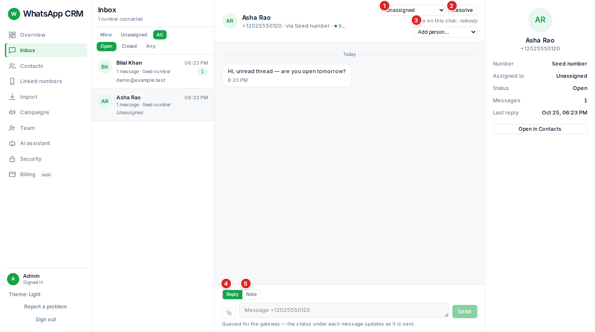
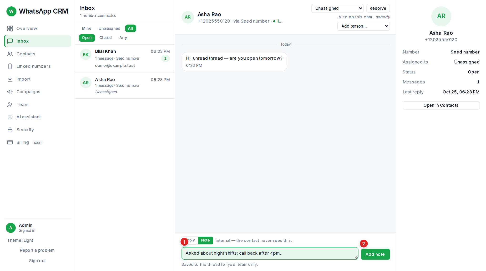

Each row shows the person, the last activity time, an unread count, how many messages, which of your numbers it is on, who owns it (or *Unassigned*), a **closed** badge, and a red **⚠** if a message in it is waiting to be sent. The list refreshes itself every few seconds.

## Handing one chat to the AI

In the chat header, **Hand to AI** gives this one conversation to the AI assistant (it needs to be switched on); **Take back from AI** returns it to you. The AI stops at once when you take it back. This is the same as choosing the AI assistant as the assignee.

## When a customer’s phone says “Waiting for this message”

Under a message you sent you may see **delivered, but the other phone could not read it yet**. That means WhatsApp delivered it but their phone could not unlock it, so it shows “Waiting for this message” for them until it works. It usually fixes itself in a moment. If the composer says **the encryption session of this number looks broken**, unlink the number on **Linked numbers** and link it again. Messages you type on your own phone or on WhatsApp Web only reach the inbox once that is fixed.

## Inside a conversation

The right-hand panel shows the contact, who it is assigned to, its status and the number of messages, with **Open in Contacts**.

## Replying

1.  Type in the box and press **Send** (or press Enter; Shift+Enter makes a new line).
2.  The 📎 button attaches a file (image, video, audio, PDF or Office document). It sends as soon as you choose it, and anything typed becomes its caption.
3.  If your organisation has **saved replies**, a **Saved reply…** dropdown inserts one; `{{name}}` becomes the person’s name.
4.  Watch the little status under each message: sent, delivered, read or failed.

## Internal notes

Press **Note**, type, and press **Add note**. Notes appear in the thread, centred and marked "internal, not sent". Use them to hand a chat over ("asked about night shifts, call back after 4pm").

## Chat ownership: assigning, resolving, adding people

-   **Assign** a chat to yourself to take it, or to a colleague to hand it on. If you assign it to the **AI assistant**, the assistant answers (see the AI chapter).
-   A chat owned by another agent is **locked** to you: you can read it and add notes, but Reply is disabled until it is reassigned to you. Admins and people added to the chat are never locked.
-   **Resolve** when the conversation is finished; **Reopen** if it picks up again.

## Warnings you may meet in a chat

| You see | What it means and what to do |
| --- | --- |
| **"Someone else is on this chat. Send anyway?"** | A colleague is typing or just replied. Press **Wait** to avoid answering twice, or **Send anyway**. |
| **⚠ waiting: pacing — spacing sends to protect the number** | The number is pacing itself. Nothing to do; it sends on its own. |
| **⚠ waiting: the number is quarantined / cooling off / isn’t connected** | The number needs attention. See **Linked numbers**. A message waits safely until it can go. |
| **⚠ waiting: it’s night where they are** | It will go in their morning. |
| **This contact is marked do not contact** | Replies are blocked. You can still add a note. *(admin only)* An admin can tick **Send anyway (override do-not-contact)** and give a reason. |
| **sent · no delivery for 30m** | WhatsApp has not confirmed delivery. The person may be offline. |
| **attachment could not be fetched** | The file expired on WhatsApp’s side. Ask them to send it again. |
