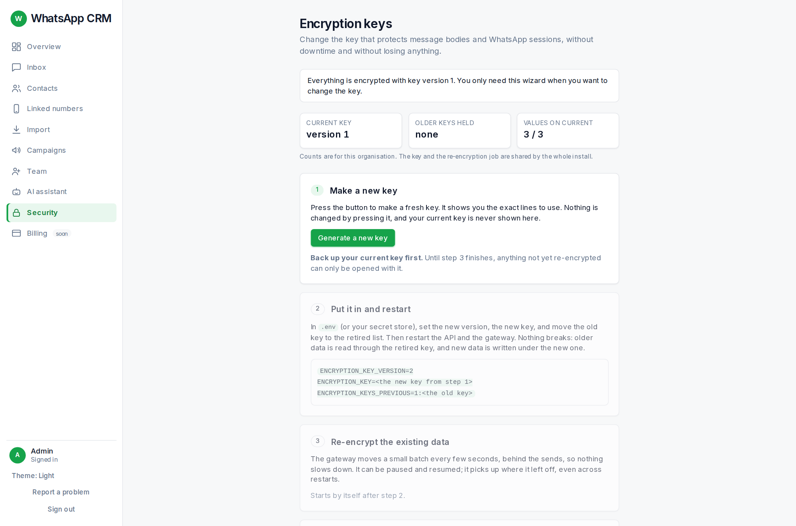

Messages and WhatsApp sign-ins are stored encrypted. The **Security** page (admin content) lets an admin change the key that protects them without downtime and without losing anything.

You only need this when you want to **rotate** the key (for example on a schedule, or if you think it leaked). The page shows the current key version and walks through five steps: make a new key; put it in the server settings and restart; re-encrypt the existing data (a progress bar, with pause and resume); verify that the new key opens everything; retire the old key. Steps 2 and 5 are done on the server by whoever runs it. **Back up the current key first**: without it, stored data cannot be read.
