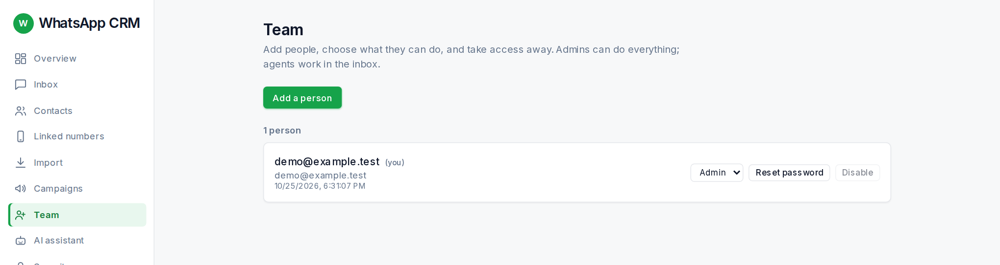

*(admin only)* The **Team** page is where admins add people and decide what they can do.

1.  Press **Add a person**. Fill in **Name**, **Email** and **Role** (Agent works in the inbox; Admin manages everything including the team).
2.  A strong password is suggested. Use **Generate another** for a different one.
3.  Press **Add person**. A green box shows the email and password **once**. Copy them and send them to the person privately.

-   Change someone’s role from the dropdown on their row.
-   **Reset password** sets a new one and signs that person out everywhere.
-   **Disable** takes access away at once (**Enable** brings it back). You cannot disable yourself, and there must always be at least one active admin.
-   The **AI assistant** appears in the list with an AI badge. It is managed on its own page, not here.
