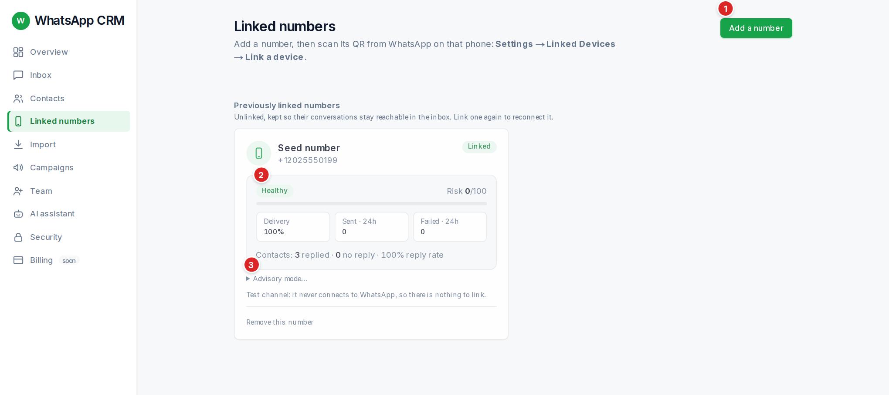

## Adding and linking a number

1.  Press **Add a number**, give it a **Name** (for example "Sales line") and press **Add number**.
2.  A linking panel opens. Choose **Scan a QR** or **Type a code**.
3.  **Scan a QR:** on the phone, open WhatsApp, then **Settings → Linked Devices → Link a device** and scan the QR on screen. It shows a countdown ("Expires in m:ss").
4.  **Type a code:** enter the phone number in full international form (for example +919876543210), press **Link this number**, then on that phone choose **Settings → Linked Devices → Link with phone number** and type the code shown.
5.  When it works you see a green tick and the badge turns **Linked**. Any message that was waiting is sent within a minute. The page then offers **Import your contacts** and **Open campaigns**.

:::tip
If the QR or code expires, nothing was connected. Press **Try again** for a fresh one.
:::

## Reading a number’s card

| You see | It means |
| --- | --- |
| **Linked / Linking… / Not linked** | Whether the CRM is connected to that number right now. |
| **Healthy / Degraded / Quarantined** | How safe the number looks to WhatsApp. Degraded sends slower. Quarantined holds sending until it recovers. |
| **Risk N/100** | Green under 30, amber 30 to 59, red 60 or more. It rises when messages fail or are not replied to. |
| **Delivery, Sent · 24h, Failed · 24h** | How the last day went. |
| **Contacts: N replied · N no reply** | People who answer protect the number. A number that only sends and never gets replies looks like spam. |
| **Cooling off after…** | WhatsApp pushed back (for example a rate limit). Sending pauses, then ramps back up. |
| **WhatsApp may be limiting this number** | Delivery slowed or stuck. Sending is slowed. It clears itself if delivery recovers. |
| **This number looks restricted by WhatsApp** | Messages are not being delivered. Its campaigns are paused. Do not push more through it. |
| **WhatsApp refused / logged this number out** | Open WhatsApp on that phone and look for a ban notice. If there is one, stop and do not relink. If not, someone unlinked the device: link once more. |

## Unlinking

**Unlink / reset this number** logs it out and clears the stored sign-in, so linking again shows a fresh QR. Conversations stay in the inbox under **Previously linked numbers**.

## Advisory mode *(admin only)*

:::caution
Under **Advisory mode…** an admin can turn anti-ban enforcement **off** for one number (a written reason is required). This is for throwaway test numbers only: a ban is permanent. Do-not-contact is never relaxed, even then.
:::
