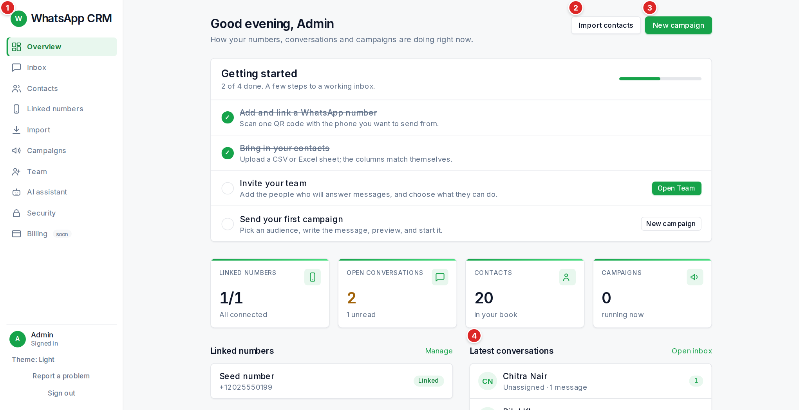

The four tiles show **Linked numbers** (connected out of total), **Open conversations** (and how many are unread), **Contacts** and **Campaigns** running now. Under them: your numbers (**Manage**), the latest conversations (**Open inbox**) and recent campaigns (**All campaigns**).

New workspaces also show a **Getting started** checklist, which disappears when every step is done:

1.  **Add and link a WhatsApp number** — scan one QR code with the phone you want to send from.
2.  **Bring in your contacts** — upload a CSV or Excel sheet; the columns match themselves.
3.  **Invite your team** *(admin only)* — add the people who will answer messages.
4.  **Send your first campaign** — pick an audience, write the message, preview and start.

Two warnings can appear on this page. **"One number needs attention"** means a number is quarantined or degraded: open **Linked numbers**. **"N messages are queued and not sent yet"** usually means a number is not connected or is pacing itself.
