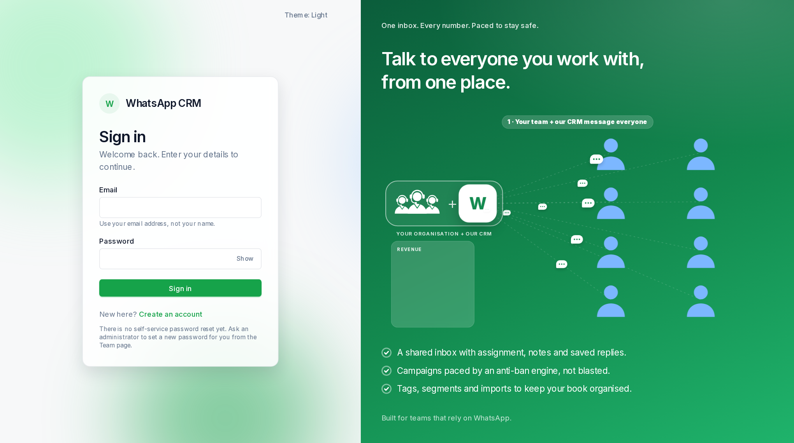

## Signing in

1.  Open the address your administrator gave you.
2.  Type your **Email** (your email address, not your name) and your **Password**. Use **Show** to check what you typed.
3.  Press **Sign in**. You stay signed in for 7 days.

**Forgot your password?** There is no self-service reset yet. Ask an admin to set a new one for you on the Team page. **Creating your own account** from the sign-in screen does not work yet either: an admin adds people from the Team page.

## The menu on the left

| Tab | What it is for |
| --- | --- |
| **Overview** | A summary of today and a checklist to get started. |
| **Inbox** | Your conversations. Reply to customers here. |
| **Contacts** | Your contact book: people, tags, custom fields. |
| **Linked numbers** | The WhatsApp numbers you send from. A red count here means a number may be limited. |
| **Import** | Bring contacts in from a CSV or Excel sheet. |
| **Campaigns** | Send one message to many people. |
| **Team** *(admin only)* | Add people, choose their role, reset passwords. |
| **AI assistant** *(admin only)* | Switch on and instruct the AI assistant. |
| **Security** | Encryption keys (admins only see the content). |
| **Billing** | Not built yet. |

At the bottom of the menu: the **Theme** button cycles Auto, Light and Dark (your browser remembers it), and **Sign out** ends your session. On a phone or a narrow window the menu becomes a bar of icons across the top.
